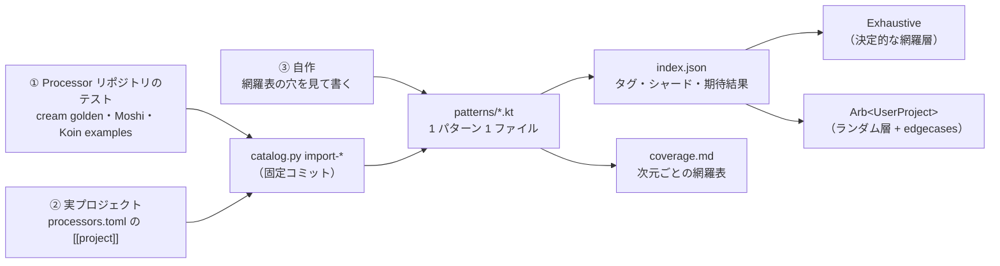

# 入力パターンカタログ（実装者向け）

決定の理由と代替案は ADR-020（共有フォルダ `pm/adr/ADR-020-input-pattern-catalog.md`）。データと script は [`quality/catalog/`](../../quality/catalog/README.md)。三者差分テスト全体の設計は共有フォルダの `quality/pbt-differential-design.md`（2 章・4 章）。

## 何をするものか

三者差分テストに渡す「利用者の入力コード」を、ランダムな Kotlin ではなく、実際に書かれるパターンの集まりから作る。カタログに無い入力は生成されないので、カタログの網羅がそのまま検証の網羅になる。



## 2026-11-26 時点の中身

| 対象 | ① テスト | ② 実プロジェクト | ③ 自作 | 計 |
|---|---:|---:|---:|---:|
| 共通の背景コード（CMN） | 0 | 0 | 10 | 10 |
| cream.kt（CRM） | 511 | 78 | 4 | 593 |
| Moshi（MSH） | 135 | 38 | 4 | 177 |
| Koin（KOI） | 9 | 53 | 14 | 76 |

必須の値 125 個はすべて 1 件以上のパターンで覆った。最新の数字は [coverage.md](../../quality/catalog/coverage.md)。kotlin-inject・Dagger / Hilt・Room は同じ仕組みで後から足す（ID 接頭辞 KIN・DAG・ROM を予約）。

## kotest からの使い方

読み込み口は `index.json` だけにする。パターンのソースは `path` から読む。下は PBT 基盤（ACG-40）で作る API の形の決め打ち。

```kotlin
val catalog = PatternCatalog.load()                     // quality/catalog/index.json
val usable = catalog.patterns.filter { it.status != Status.Rejected }

// 決定的な網羅層: 1 時間ごとの実行で 24 分割の 1 区画を回し、24 時間で全パターンを一巡する
// ⭐️ シャードは ID の CRC32 % 24。index.json に書いてある
val exhaustive = Exhaustive.collection(usable.filter { it.shard == hourOfDay % 24 })

// ランダム層: Processor の組に合うパターンを 1〜3 個 + 背景コード 0〜2 個で 1 プロジェクトにする
fun Arb.Companion.userProject(set: ProcessorSet): Arb<UserProject> = arbitrary(
    edgecases = usable.filter { it.fits(set) }.map { UserProject.of(it) },   // 1 パターンだけの入力
) { rs -> UserProject.compose(pickPrimary(set, rs), pickBackground(rs)) }
```

組み立ての規則（`UserProject.compose`）:

- `PROCESSORS` が Processor の組に含まれるパターンだけを選ぶ。`*` の背景コードはどの組にも混ぜてよい
- `EXPECT: error` / `compile-error` のパターンは 1 プロジェクトに 1 個まで。混ぜたら全体の期待結果はそのエラーになる
- パッケージがぶつかるときは、パターン ID を付けたパッケージに付け替える（K・B・N に同じ入力を渡すので比較は崩れない）
- `OPTIONS` があるパターンは、その組を優先して使う。無ければ `Arb<Options>` から引く
- 縮小（shrinking）はパターン単位、次にファイル単位で外していく

## パターンの状態と K での確認

①② の取り込みは、ファイル単体を抜き出すので、そのままではコンパイルできないものがある。そこで状態を 3 つに分ける。

| 状態 | 意味 | Arb に使うか |
|---|---|---|
| `candidate` | まだ K（KSP2）で動かしていない | 決定的な網羅層だけで使い、K の結果で状態を決める |
| `verified` | K の結果が `EXPECT` どおり。K の出力を期待値として記録した | 使う |
| `rejected` | K の結果が `EXPECT` と違う（依存が足りない・固定版の既知の不具合など）。`NOTE` に理由 | 使わない。網羅表でも数えない |

状態の書き換えは差分ハーネス（ACG-42）が行い、PR で人が確かめる。網羅率の合格条件（必須の値が 100%）は、M1 以降は `verified` だけで数える。

## 取り込みの規則

| 出所 | 単位 | 取り込み方 |
|---|---|---|
| cream.kt ① | golden 1 個の入力 | `## Input` のコードを抜き出し、同じ入力は 1 つにまとめる。KSP options の既定値以外を `OPTIONS` に、`## Compiler output` があれば `EXPECT: error` |
| cream.kt ② | test モジュールのファイル | 外部の利用プロジェクトが無いので、KMP の統合テスト用モジュール（commonMain）で代える（ADR-019） |
| Moshi ① | processor テストの 1 関数 / 実行時テストの `@JsonClass` 宣言 1 個 | 前者はソース文字列と診断。後者は宣言と、同じファイル内で参照している宣言を一緒に取り出す |
| Koin ① | examples のサンプルモジュール 1 個 | テストソースを除いたモジュール丸ごと |
| ② 実プロジェクト | アノテーションを含むファイル 1 個 | 1 プロジェクト最大 30 件。新しいタグが増える順に選び、10 件を超えて増えなくなったら止める |

版を上げたら `processors.toml` のコミットを直して `catalog.py import-all` をやり直す。ID は `id-map.tsv` で固定されるので、同じ出所は同じ ID のまま残る。

## 網羅表の読み方

`coverage.md` は、次元（`dimensions.toml`）の値ごとに、その値を含むパターンの数を出所別に数える。タグは正規表現による自動付与と `TAGS` の手付けの和。正規表現は「その要素が入力にある」ことの目安で、厳密な構文解析ではない。

- ⚠️ が付いた値: 必須なのに 0 件。`catalog.py check` が失敗する
- 薄いところ: 必須で 1〜2 件しかない値。③ を足す候補
