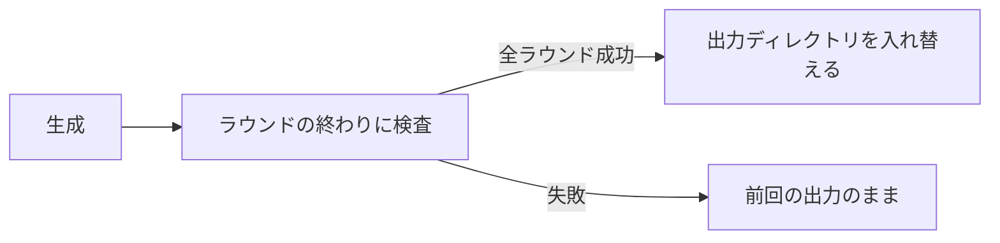

:::note[レビューで判断してほしいこと]
- 生成物を確定するのは全ラウンドが成功したときだけにした（失敗したら出力は前回のまま）
- 出力ディレクトリに手で置いたファイルは、警告を出して消す
:::

生成は `context.codeGenerator` を通して行います。フレームワークは書かれた内容を検査し、ビルドが成功したときにだけ出力ディレクトリへ反映します。

## Kotlin のファイルを生成する

`generateKotlin` にパッケージ名・ファイル名・依存・内容を渡します。

```kotlin title="registry-processor/src/main/kotlin/com/example/registry/RouteRegistryProcessor.kt"
        context.codeGenerator.generateKotlin(
            packageName = "com.example.generated",
            fileName = "Routes",
            dependencies = dependencies,
            content = "${header}package com.example.generated\n\n" +
                "val routes: List<String> = listOf(${names.joinToString { "\"$it\"" }})\n",
        )
```

パッケージ名から `com/example/generated/Routes.kt` の場所が決まります。`dependencies` の書き方は[増分処理と依存の宣言](/analysis-code-gen/guides/incremental/)にあります。

## リソースを生成する

Java のソースは `generateJava`、それ以外のファイルは `generateResource` で作ります。

```kotlin title="registry-processor/src/main/kotlin/com/example/registry/RouteRegistryProcessor.kt"
        context.codeGenerator.generateResource(
            relativePath = "META-INF/routes.txt",
            dependencies = Dependencies.aggregating(files),
            content = names.joinToString("\n", postfix = "\n").toByteArray(),
        )
```

文字コードは UTF-8、改行は LF にそろえて書かれます。

## 出力先

生成物は実行単位ごとのディレクトリに出て、そのままコンパイルに入ります。

```text
build/generated/analysisCodeGen/
├── main/{kotlin,java,resources}                  # SourceSet ごとの実行
└── compilations/jvmMain/{kotlin,java,resources}  # Compilation ごとの実行
```

このディレクトリはタスクのものです。手で置いたファイルは次のビルドで消えます。

## 書けない場所と重複

出力ディレクトリの外やソースへの書き込みは、呼んだ時点で例外になります。同じパスへの 2 回目の書き込みもエラーです。

```text
e: [RouteRegistryProcessor] と [OtherProcessor] が同じファイルに書きました:
   com/example/generated/Routes.kt
```

後のラウンドで同じ内容を書き直すのは許されます。内容が違うとエラーです。

## 失敗したときの生成物

生成物はラウンドの終わりに検査され、全ラウンドが成功してから出力ディレクトリに入れ替わります。



ビルドを途中で止めても、出力が中途半端に残ることはありません。次のビルドは全件処理になります。

## まとめ

| 要素 | 役割 |
|---|---|
| `generateKotlin` / `generateJava` | パッケージ名とファイル名からソースを生成する |
| `generateResource` | パスを指定してファイルを生成する |
| 出力ディレクトリ | 実行単位ごと。タスクが管理する |
| 重複の検査 | 同じパスへの書き込みはエラー |
| 確定 | 全ラウンドが成功したときだけ |

## 次のステップ

- [増分処理と依存の宣言](/analysis-code-gen/guides/incremental/): `dependencies` の選び方
- [ラウンドとファイル集合](/analysis-code-gen/guides/rounds/): 生成物を次のラウンドで処理する
