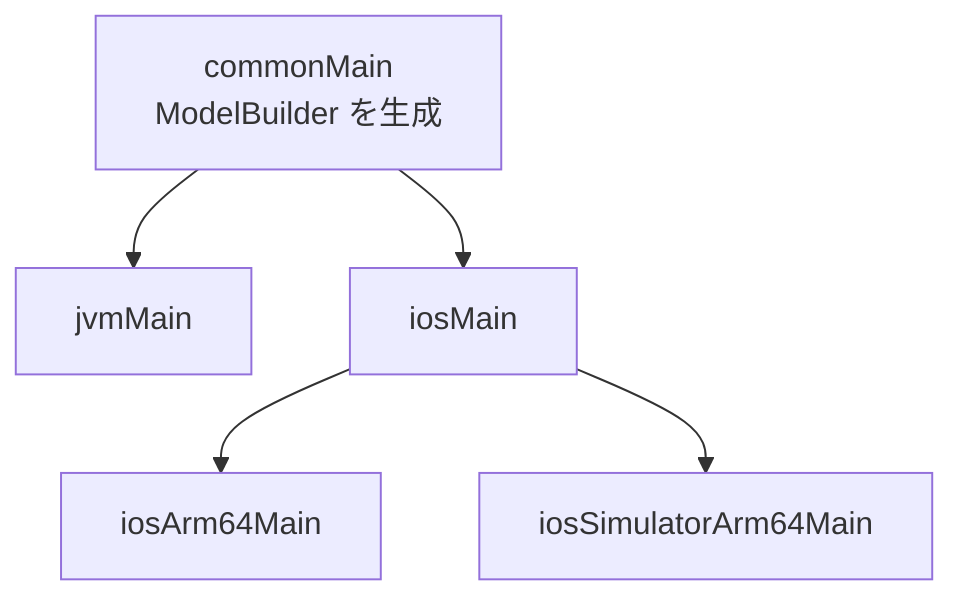

:::note[レビューで判断してほしいこと]
- SourceSet ごとの実行を基本にし、Compilation ごとの実行は必要なときに選ぶ形でよいか
- Compilation ごとの実行では、`sourceSet` をその Compilation の default SourceSet（`jvmMain` など）にした
:::

analysisCodeGen は、KMP の SourceSet ごとに Processor を動かします。`commonMain` で生成したものは、`jvmMain` や `iosMain` から普通のソースとして見えます。

## SourceSet ごとに生成する

Processor を付ける SourceSet を `sourceSets { }` で選びます。

```kotlin title="kmp-lib/build.gradle.kts"
        // commonMain で 1 回だけ生成し、下流の SourceSet から使う
        commonMain { processor(project(":builder-processor")) }
```

生成物はその SourceSet のものになり、`dependsOn` でつながる下流に引き継がれます。



## 処理対象を上流に広げる

既定では、自分の SourceSet のファイルだけが処理対象です。上流の宣言も処理したいときは `processingScope` を広げます。

```kotlin title="kmp-lib/build.gradle.kts"
        iosMain {
            processor(project(":greeting-processor"))
            processingScope = ProcessingScope.IncludeDependsOn
        }
```

`commonMain` の宣言から `iosMain` 向けの実装を作るときに使います。出力先は `iosMain` のままです。

## Compilation ごとに生成する

DI の登録一覧のように、ターゲットごとに全ソースを見たい生成は `compilations { }` に付けます。

```kotlin title="kmp-lib/build.gradle.kts"
    compilations {
        // 一覧は Compilation ごとに、その Compilation の全ソースから作る
        all { processor(project(":registry-processor")) }
    }
```

Compilation の生成物は、その Compilation だけに入ります。他のターゲットからは見えません。

## Processor で実行単位を見分ける

同じ Processor が両方の実行単位で動けます。`executionUnit` で見分けます。

```kotlin title="registry-processor/src/main/kotlin/com/example/registry/Platform.kt"
    when (context.executionUnit) {
        // Compilation ごと: target と Compilation の名前が取れる
        is ExecutionUnit.CompilationUnit -> {
            val compilation = context.compilation!!
            "${compilation.targetName} の ${compilation.compilationName}"
        }
        // SourceSet ごと: compilation は null
        is ExecutionUnit.SourceSetUnit -> context.sourceSet.name
    }
```

`sourceSet.module` は AA の `KaSourceModule` です。その SourceSet の Platform で解析されます。

## まとめ

| 実行単位 | 向いている生成 | 生成物が見える範囲 |
|---|---|---|
| SourceSet | DTO・Mapper など、宣言ごとの生成 | その SourceSet と下流 |
| Compilation | DI の登録一覧など、ターゲットごとの生成 | その Compilation だけ |
| `processingScope` | 上流の宣言も処理対象にする | 出力先は変わらない |

## 次のステップ

- [Gradle DSL](/analysis-code-gen/guides/gradle-dsl/): 設定の書き方と合成の規則
- [ラウンドとファイル集合](/analysis-code-gen/guides/rounds/): `ownFiles` と `visibleFiles`
