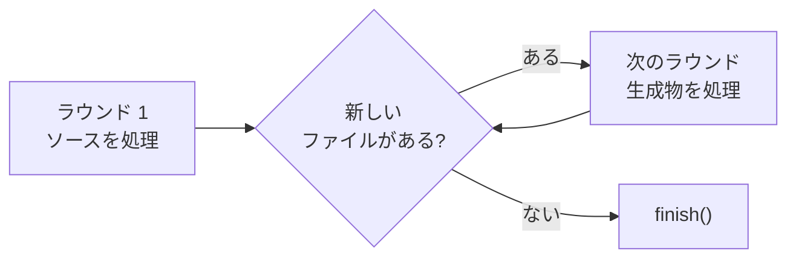

:::note[レビューで判断してほしいこと]
- 次のラウンドに進む条件を「新しいファイルが増えたときだけ」にした（Deferred が残っているだけでは進まない）
- `newFiles` の意味がラウンド 1 とそれ以降で違う（KSP の `getNewFiles` と同じ）
:::

Processor は 1 回のビルドで何度か呼ばれます。この 1 回をラウンドと呼び、生成物は次のラウンドで解析できるようになります。

## ラウンドの流れ

各ラウンドで全 Processor の `process` が呼ばれ、生成物がまとめて確定します。新しいファイルができた間だけ、次のラウンドに進みます。



同じラウンドの生成物は、他の Processor からも見えません。見えるのは次のラウンドからです。

## 処理するファイルを選ぶ

普通は `newFiles` を処理します。ラウンド 1 では今回処理すべきソース、2 以降では前のラウンドの生成物が入ります。

```kotlin title="builder-processor/src/main/kotlin/com/example/builder/BuilderProcessor.kt"
    override fun process(context: AnalysisCodegenRoundContext) {
        // ラウンド 1 は今回処理すべきソース、2 以降は前のラウンドで生成されたファイル
        context.logger.info("round ${context.round}: ${context.newFiles.size} 個を処理します")
        for (file in context.newFiles) {
            analyze(file) {
                file.declarations.filterIsInstance<KtClass>()
                    .filter { it.classSymbol?.annotations?.contains(BUILDER) == true }
                    .forEach { generateBuilder(context, file, it) }
            }
        }
    }
```

こう書くと、他の Processor が生成したクラスに付いた `@Builder` も、次のラウンドで処理されます。

## ファイル集合の一覧

ラウンドの入力には、目的の違うファイル集合が並んでいます。

```kotlin
context.allFiles          // 処理対象の Kotlin ファイル全部
context.newFiles          // このラウンドで処理すべきもの
context.sourceSet.visibleFiles // 解析で見える上流のファイルも含めたもの
```

| プロパティ | 中身 |
|---|---|
| `allFiles` | 処理対象（Processing Scope）の Kotlin ファイル。前のラウンドの生成物を含む |
| `allJavaFiles` | 処理対象の Java ソース |
| `newFiles` | ラウンド 1 は今回処理すべきソース、2 以降は前のラウンドの生成物 |
| `changedFiles` | ラウンド 1 だけ。前回のビルドから内容が変わったもの |
| `removedFilePaths` | ラウンド 1 だけ。前回あって消えたソースのパス |
| `sourceSet.ownFiles` | その SourceSet のソースと生成物 |
| `sourceSet.visibleFiles` | ownFiles と、`dependsOn` を遡った上流のファイル |

どれもパスの辞書順に並びます。増分ビルドでの中身は[増分処理と依存の宣言](/analysis-code-gen/guides/incremental/)にあります。

## ラウンドが止まらないとき

生成物から毎回新しいファイルを作り続けると、ラウンドが終わりません。上限は `maxRounds` で変えられます。

```kotlin title="app/build.gradle.kts"
    // ラウンド数の上限（既定 100）
    maxRounds = 10
```

上限を超えるとエラーになり、最後のラウンドで生成した Processor とパスが出ます。

## まとめ

| 要素 | 役割 |
|---|---|
| ラウンド | 新しいファイルができた間だけ繰り返す |
| `round` | 1 から始まるラウンド番号 |
| `newFiles` | そのラウンドで処理すべきファイル |
| `allFiles` | 処理対象のファイル全部 |
| `maxRounds` | ラウンド数の上限 |

## 次のステップ

- [生成と出力の管理](/analysis-code-gen/guides/code-generator/): 生成物の確定と出力先
- [Deferred](/analysis-code-gen/guides/deferred/): 解決できないものを次のラウンドへ
