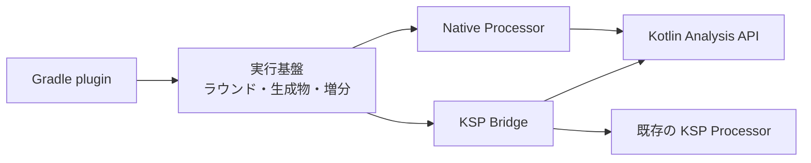

:::note[レビューで判断してほしいこと]
- 「KSP2 の代わりに、解析は AA にそのまま任せる」という位置付けが伝わるか
- 使い方を Native Processor と KSP Bridge の 2 つに分ける見せ方でよいか
:::

analysisCodeGen は、Kotlin Analysis API（AA）を Processor から直接使えるコード生成フレームワークです。

KSP2 の実行基盤を受け継ぎ、KMP の SourceSet ごとの生成と、KSP2 に劣らない性能を目指します。

:::caution[開発中]
まだ実装前で、動きません。このサイトは実装を始める前に決めた仕様です。
:::

## 解析は AA に任せる

KSP は独自の解析 API（`KSDeclaration` など）を持ちますが、analysisCodeGen は持ちません。Processor は AA の `analyze { }` でそのまま解析します。

```kotlin
override fun process(context: AnalysisCodegenRoundContext) {
    for (file in context.newFiles) {
        analyze(file) {
            // KaSymbol・KaType・関数の本体まで、AA の機能をそのまま使える
        }
    }
}
```

ラウンドの管理、生成物の管理、増分処理はフレームワークが受け持ちます。

## 全体の流れ

Gradle plugin が Kotlin の SourceSet や Compilation を読み取り、実行単位ごとに Processor を動かします。KSP の Processor も、同じ実行基盤の上で動かせます。



## KSP2 との違い

| 観点 | KSP2 | analysisCodeGen |
|---|---|---|
| 解析 API | KSP 独自の API | AA と PSI をそのまま使う |
| 式・関数の本体の解析 | 原則できない | できる |
| KMP の SourceSet ごとの生成 | 制約がある | 第一級に扱う |
| 既存の KSP Processor | そのまま動く | KSP Bridge で動く |

宣言とアノテーションだけを見る Processor なら、KSP2 のままで十分です。関数の本体や呼び出し先まで解析したいときや、KMP の共通 SourceSet に 1 回だけ生成したいときに向いています。

## 2 つの使い方

自分で書く Processor は Native Processor として、既存の KSP Processor は KSP Bridge で動かします。どちらも同じ `analysisCodeGen` の依存に足すだけです。

```kotlin
dependencies {
    // Native Processor
    analysisCodeGen("com.example:hello-processor:1.0")
    // KSP Processor（KSP Bridge で動く）
    analysisCodeGen("com.squareup.moshi:moshi-kotlin-codegen:1.15.2")
}
```

KSP Processor を使うときは、Bridge の plugin も適用します。手順は[インストール](/analysis-code-gen/start/install/)にあります。

## 対応する環境

| 項目 | 対応 |
|---|---|
| Kotlin | 2.4.0 以降のすべての stable と、最新のプレリリース 1 つ |
| プロジェクト | Kotlin/JVM、Kotlin Multiplatform、Android |
| Gradle を動かす JDK | 17 以上 |

analysisCodeGen の 1 つの版で、対応範囲のどの Kotlin でも動きます。実行時に、利用者の Kotlin と同じ版の AA を使います。

## 次のステップ

- [クイックスタート](/analysis-code-gen/start/quick-start/): 小さな Processor を書いて動かす
- [インストール](/analysis-code-gen/start/install/): 既存のプロジェクトに組み込む
