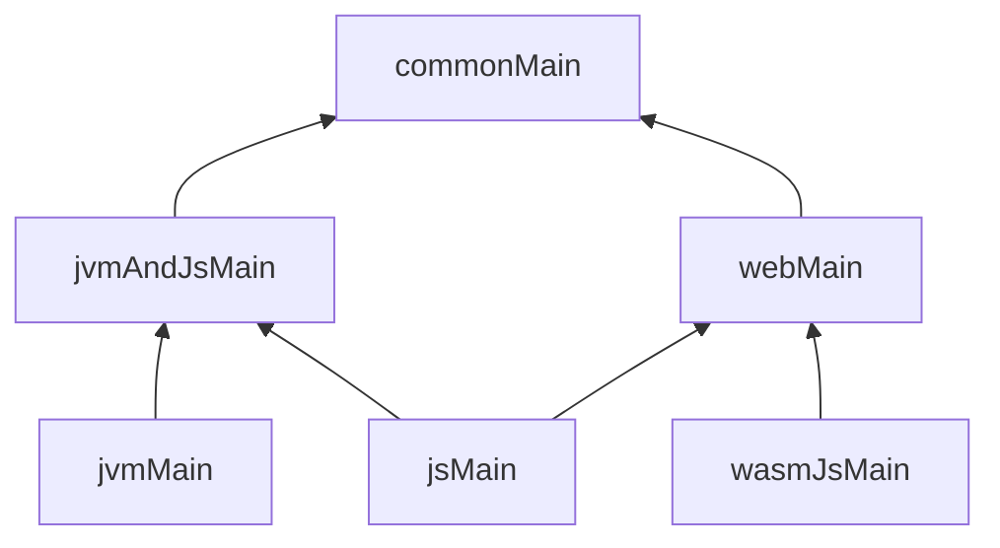

:::note[レビューで判断してほしいこと]
- KMP の解析を Compilation ではなく SourceSet 単位にする（SourceSet First）判断を、P-01 の結果で確定してよいか
- Apple / Native の KLIB は未検証のまま G0 を通し、M1 までに手元の Mac で追試する扱いでよいか
- P-02 で時間の条件（作り直しの 50% 以下）は未達（61%）だが、正しさが成立したので維持方式を採る判断でよいか
:::

analysisCodeGen は、Analysis API（AA）の Standalone モードで解析環境を作ります。KMP の SourceSet は、1 つずつ AA のソースモジュールにします。

## SourceSet を Module Graph にする

1 つの SourceSet を 1 つの `KaSourceModule` にし、`dependsOn` をモジュール間の依存として張ります。



KSP2 は Compilation ごとにしか解析しません。analysisCodeGen は中間の SourceSet（`jvmAndJsMain` や `appleMain`）も単独で解析し、そこに生成物を置きます。

## モジュールの組み方

P-01 の検証で、次の組み方がコンパイラと同じ結果になると確かめました（ADR-009）。

| 項目 | 決めたこと |
|---|---|
| モジュール | 1 SourceSet = 1 `KaSourceModule`。`dependsOn` は `addDependsOnDependency` |
| 共通・中間の依存 | その SourceSet の metadata Compilation の classpath（Gradle が変換した metadata KLIB） |
| 固有の依存 | platform Compilation の classpath と JDK |
| 上位の SourceSet | KGP が classpath に入れる上位の出力は使わず、ソースモジュールの `dependsOn` で表す |
| platform | その SourceSet を含む target の platform の和集合 |
| 言語設定 | `MultiPlatformProjects` を有効にする。無いと expect / actual がすべてエラーになる |
| Session | プロジェクト全体で 1 つ。上位の SourceSet の解析を下位と共有する |

## P-01 で確かめたこと

KGP 2.4.21 の KMP サンプルに、各層でわざとエラーを入れ、AA の診断を KGP の実コンパイルと比べました。

| 指標 | 結果 |
|---|---|
| 中間・ひし形を含む 6 SourceSet を単独で解析できる | すべてできた |
| エラー 10 件の位置とメッセージ | すべて一致 |
| expect / actual の対応と呼び出し先（14 件） | すべて一致 |
| stdlib・coroutines の metadata KLIB | そのまま読めた |
| 時間（参考） | 初回 2.9 秒（JVM 起動込み）、以降 1 SourceSet 0.15〜0.9 秒 |

再現の手順はリポジトリの `poc/p01/` にあります。

## Processor から見える API

共通の SourceSet で見える API は、その SourceSet の metadata コンパイルと同じです。固有の Compilation から見たものではありません。

```kotlin
// commonMain
val file = java.io.File("a.txt") // commonMain の解析ではエラー（compileKotlinJvm では通る）
```

固有の Compilation は共通のコードも JVM の依存で解決するため、見え方が違います。Processor が共通の SourceSet で JVM の API を探すと見つかりません。

## 既知の差異

expect class のメンバーを actual 側から引くと、`containingModule` が actual 側のモジュールを返します。PSI のファイルは共通側のままです。

このため、解析結果を SourceSet に帰属させるときは `containingModule` を使わず、宣言の PSI ファイルが属する SourceSet を使います。

## ラウンド間の環境の維持

ラウンドごとに解析環境を作り直さず、維持したまま生成物を差分で反映します。KSP2 と同じ手順です（P-02、ADR-010）。


無効化には `publishGlobalSourceModuleStateModificationEvent` と `dropPsiCaches` を使います。無効化を抜くと、既存の宣言の解決結果（上位型など）が古いまま残ります。

`KaSession` や `KaSymbol` の有効期間は延ばしません。ラウンドをまたいで持ち越せるのは Pointer などだけです。

## P-02 で確かめたこと

200・1000 ファイルの入力で、維持した環境と毎ラウンド作り直した環境の解析結果を比べました。

| 指標 | 目標 | 結果 |
|---|---|---|
| 全ラウンドの解析結果 | 作り直しと一致 | 一致した（依存 JAR の有無、宣言レベル・全解析のどれでも） |
| 2 ラウンド目の時間 | 作り直しの 50% 以下 | 未達。61%（1000 ファイルで 72%） |
| 3 ラウンド目の時間 | （参考） | 43〜50% |

ラウンド間の処理そのものは 3〜4 倍速くなります。ただ、無効化した後の再解析は、新しい環境での解析とほぼ同じ時間がかかります。

このため「維持すれば半分以下」を性能設計の前提にはしません。作り直す方式はどの条件でも遅いので採りません。

さらに速くする余地は、KMP で無効化する範囲を生成先の SourceSet とその下流に狭めることです。P-05 で測ります。

## 未検証のこと

| 項目 | 予定 |
|---|---|
| Apple / Native の KLIB（`appleMain` など） | G0 の後、M1 までに手元の Mac で同じ手順を追試する |
| 下位の SourceSet を全部見ないと出ない診断（`NO_ACTUAL_FOR_EXPECT` など） | Processor には不要なので対象外。必要になれば Session 全体で確かめる |
| 無効化の範囲を SourceSet の単位に狭める効果と、初回（Cold）の時間 | P-05 で測る |
