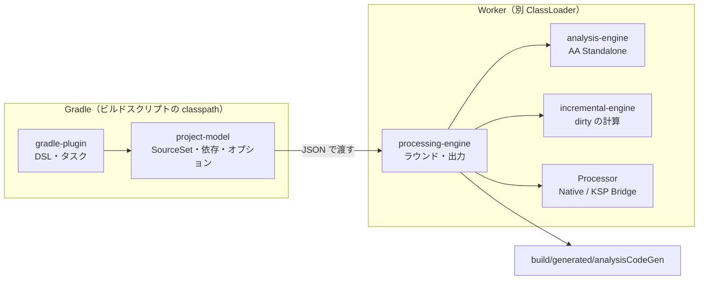

:::note[レビューで判断してほしいこと]
- Internal は Processor の作者が読まなくてよい前提で、実装者向けの粒度で書いてよいか
- 解析環境の維持（P-02）は検証中のため、結論が出たら[解析環境と Module Graph](/analysis-code-gen/internal/analysis-environment/)に足す
:::

このセクションは、analysisCodeGen の中の仕組みを説明します。Processor を書くだけなら読まなくて構いません。決定の理由は、各ページから ADR（設計の決定記録）をたどれます。

## 全体像

Gradle plugin は設定を集めてプロジェクトモデルにするだけで、解析と生成は Worker の中のエンジンが行います。

ビルドスクリプトの classpath には、AA も IntelliJ Platform も載せません。エンジン一式は Worker の別 ClassLoader に読み込みます。

こうすると、コンパイラや AA の版が利用者のビルドとぶつかりません。

## 1 回の実行の流れ

タスク 1 つが、実行単位（SourceSet か Compilation）1 つを処理します。

1. gradle-plugin が実行単位の SourceSet・依存・オプションをプロジェクトモデルにまとめる
2. incremental-engine が前回の入力と比べ、全件処理か増分かを決め、処理するファイルを選ぶ
3. analysis-engine が AA の解析環境を作り、KMP の SourceSet を Module Graph として組む
4. processing-engine が Processor をラウンドごとに回し、生成物を解析対象に足していく
5. すべてのラウンドが成功したら、生成物を出力ディレクトリに入れ替え、増分のキャッシュを書く

Native の Processor も KSP Bridge 上の Processor も、この同じ流れを通ります。

## ページ

| ページ | 内容 | 主な ADR |
|---|---|---|
| [モジュールと依存の向き](/analysis-code-gen/internal/modules/) | モジュールの役割・公開範囲・依存の向き | ADR-012 |
| [解析環境と Module Graph](/analysis-code-gen/internal/analysis-environment/) | AA の環境の作り方と KMP の SourceSet の扱い | ADR-009・ADR-010 |
| [ラウンドと増分処理](/analysis-code-gen/internal/rounds/) | ラウンドの止め方・出力の確定・dirty の計算 | ADR-014・ADR-015 |
| [KSP Bridge の仕組み](/analysis-code-gen/internal/ksp-bridge/) | KSP の Processor がエンジンに参加する方法 | ADR-017・ADR-018 |

ADR の本文は、プロジェクトの共有フォルダの `pm/adr/` にあります。
