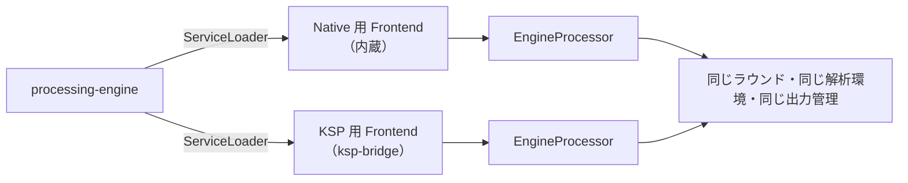

:::note[レビューで判断してほしいこと]
- KSP API の実装を KSP2 2.3.14 から移植し、エンジンとは engine-spi だけでつなぐ方式でよいか
:::

KSP Bridge は、公式の KSP API（`Resolver` や `KSClassDeclaration`）を analysisCodeGen のエンジンの上に実装したものです。

決定の理由は ADR-017（SPI）と ADR-018（移植元）にあります。

## エンジンへの参加の仕方

Bridge はエンジンに直接依存しません。エンジンは ServiceLoader で `ProcessorFrontend` を探し、Processor の依存ごとに扱えるものを返してもらいます。



Native の Processor も、エンジンの中では同じ `EngineProcessor` として回ります。このため Bridge のテストが、そのままエンジンの検証にもなります。

## engine-spi の型

すべて `@InternalAnalysisCodegenApi` で、利用者には見せません。

| 型 | 役割 |
|---|---|
| `ProcessorFrontend` | Processor の依存 1 件を受け取り、扱える Processor を返す |
| `EngineProcessor` | エンジンが回す単位。`process`・`finish`・`onError` |
| `EngineRoundContext` | 公開のラウンドの情報に、生の出力口と解析環境への入口を足したもの |
| `OutputSink` | 生の出力口。同じパスへの 2 回目の書き込みの扱いを選べる |
| `AnalysisAccess` | IntelliJ の `Project`・`KaSourceModule`・`analyze` の入口 |
| `IncrementalParticipant` | 増分処理への参加口。KSP の Lookup 追跡から dirty なファイルを足す |

## どちらの Provider を使うか

Processor の依存（Gradle の 1 つの座標）ごとに決めます。

| その依存にあるもの | 使うもの |
|---|---|
| `AnalysisCodegenProcessorProvider` | Native だけ。KSP の Provider は使わない |
| `SymbolProcessorProvider` だけ | Bridge が適用されていれば KSP として使う。無ければエラー |
| どちらも無い | 警告して無視する |

同じ jar に両方の Provider があっても、二重に生成しません。

## KSP との互換のために

公開 API には無い KSP の挙動は、SPI を通して Bridge 側で実装します。

- 同じファイルの 2 回目の `createNewFile` で、KSP と同じ `FileAlreadyExistsException`
- `finish()` の中での生成を許す。その生成物は次のラウンドの入力にならない
- `Dependencies(aggregating, files)` を、増分処理の `aggregating` / `isolating` に写す
- 追跡できない操作が起きたら、全件処理を求める

## KMP での見え方

既定の `Compatible` モードでは、`getAllFiles()` が KSP2 と同じく「その Compilation の全ソース」になります。

```kotlin
analysisCodeGen {
    kspBridge { processingMode = KspProcessingMode.SourceSet }
}
```

`SourceSet` モードでは、その SourceSet の処理対象だけになります。共通の生成が 1 回で済みますが、Processor が対応している必要があります。

## 移植元と出所

KSP API の実装は、KSP2 2.3.14 から移植します。移植したファイルは、上流のヘッダの直後に出所の 3 行を書き、`porting/ksp/port-map.csv` に記録します。

```kotlin
// Ported-From: google/ksp@a3aaaabae570bae3ab4b84e72385483a14ab4498:kotlin-analysis-api/src/main/kotlin/com/google/devtools/ksp/impl/FileCache.kt
// Modified-By: analysis-code-gen contributors, 2026
// Modifications: パッケージ名を変更。キャッシュの寿命を解析セッション単位に変更。
```

出所の書き漏れは CI の検査で落ちます。書き方はリポジトリの `.claude/rules/porting.md` にあります。
