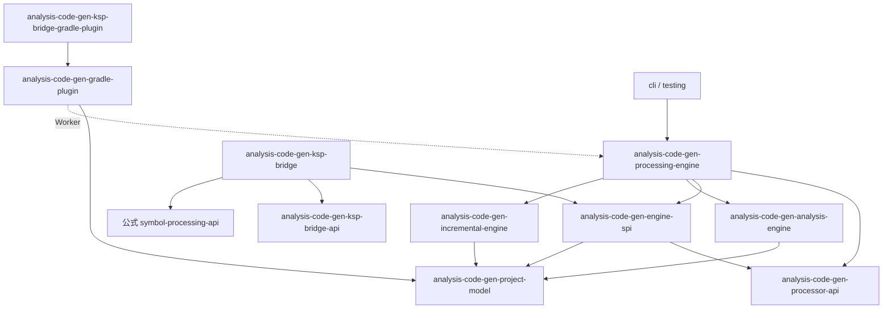

:::note[レビューで判断してほしいこと]
- KSP Bridge がエンジンに直接依存せず、analysis-code-gen-engine-spi だけを通す形でよいか
- DI フレームワークを使わず、組み立てを 1 か所に集める方針でよいか
:::

モジュールは、公開する API・Gradle 連携・解析・増分・ラウンド制御・KSP 互換で分かれています。決定の理由は ADR-012 にあります。

## モジュールの一覧

group は `me.tbsten.analysis.code.gen`、パッケージの根は `me.tbsten.analysiscodegen` です（ADR-042）。

| モジュール | 公開範囲 | 中身 |
|---|---|---|
| `analysis-code-gen-processor-api` | 公開 | Native Processor の API |
| `analysis-code-gen-gradle-plugin` | 公開（DSL） | DSL・タスク・KGP / AGP との連携 |
| `analysis-code-gen-testing` / `analysis-code-gen-testing-kct` | 公開 | Processor のテスト補助と、取り込んだ kotlin-compile-testing |
| `analysis-code-gen-ksp-bridge-api` | 公開（実験的） | Hybrid API |
| `analysis-code-gen-ksp-bridge-gradle-plugin` | 公開 | `kspBridge {}` の DSL |
| `analysis-code-gen-cli` | 公開（コマンド） | プロジェクトモデルの JSON を受けて生成する |
| `analysis-code-gen-project-model` | 内部 | Gradle にも AA にも依存しないプロジェクトモデル |
| `analysis-code-gen-engine-spi` | 内部 | エンジンに参加するための SPI |
| `analysis-code-gen-analysis-engine` | 内部 | AA Standalone の環境と Module Graph |
| `analysis-code-gen-aa-compat` | 内部 | AA の版ごとの差分 |
| `analysis-code-gen-incremental-engine` | 内部 | 依存グラフ・スナップショット・dirty の計算 |
| `analysis-code-gen-processing-engine` | 内部 | ラウンド制御・Processor の読み込み・出力 |
| `analysis-code-gen-ksp-bridge` | 内部 | KSP API の実装（KSP2 から移植） |

## 依存の向き

矢印は依存先です。点線は、ビルドスクリプトの classpath ではなく Worker の ClassLoader で読むことを表します。



## 守っていること

境界はテストで検査します。破るとビルドが落ちます。

- analysis-code-gen-ksp-bridge は analysis-code-gen-processing-engine と analysis-code-gen-analysis-engine を import しない。エンジンは ServiceLoader で Bridge を見つけるだけ
- analysis-code-gen-gradle-plugin は `org.jetbrains.kotlin.analysis` を import しない。ビルドスクリプトの classpath に AA を載せない
- analysis-code-gen-incremental-engine は AA に依存しない。ファイルの識別子と依存グラフだけを扱う
- AA の版で形が変わる呼び出しは analysis-code-gen-aa-compat の中に閉じ込める（ADR-011）

## 公開範囲の印

全モジュールで `explicitApi()` を有効にしています。内部モジュールの宣言には印を付けます。

```kotlin
@RequiresOptIn(level = RequiresOptIn.Level.ERROR)
annotation class InternalAnalysisCodegenApi

@RequiresOptIn(level = RequiresOptIn.Level.WARNING)
annotation class ExperimentalAnalysisCodegenApi
```

モジュールをまたいで使う内部の宣言には `@InternalAnalysisCodegenApi` を付けます。利用者が誤って使うとコンパイルエラーになります。

変わりうる公開 API（Hybrid API など）には `@ExperimentalAnalysisCodegenApi` を付けます。公開モジュールの API の変化は CI が検査します。

## 組み立て

DI フレームワークは使いません。各エンジンはコンストラクタで部品を受け取ります。

組み立ては analysis-code-gen-processing-engine の `EngineComponents` 1 か所に集めます。

外から差し込めるのは、ServiceLoader で探す 2 種類だけです。

- Native の `AnalysisCodegenProcessorProvider`
- Bridge が提供する `ProcessorFrontend`
