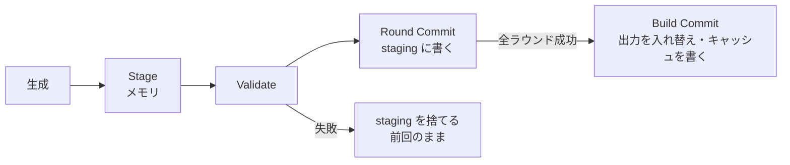

:::note[レビューで判断してほしいこと]
- Deferred が残っているだけではラウンドを進めず、既定でエラーにする方針でよいか
- 生成物の依存の宣言漏れを framework が検出しない（宣言は Processor の責任）方針でよいか
:::

1 回の実行は、複数のラウンドに分かれます。あるラウンドの生成物は、次のラウンドの入力になります。決定の理由は ADR-014（ラウンド）と ADR-015（増分）にあります。

## ラウンドの進み方

ラウンドの中では、解析対象を固定します。同じラウンドで他の Processor が作ったものは見えません。

1. 全 Processor の `process` を呼ぶ
2. 生成物をメモリに置き（Stage）、検査し（Validate）、解析対象に足す（Round Commit）
3. Round Commit で新しいパスのファイルが 1 つ以上増えたら、次のラウンドへ進む
4. 増えなければ最終ラウンドとして終える

Deferred（次のラウンドへの持ち越し）が残っているだけでは進みません。

## 止める条件

| 状況 | 扱い |
|---|---|
| ラウンド数が `maxRounds`（既定 100）を超えた | エラー。最後に生成した Processor とパスを出す |
| 新しいファイルが無いのに Deferred が残った | 既定はエラー。`unresolvedDeferred` で警告に変えられる |
| 別の Processor が同じパスに書いた | エラー。両方の Processor 名を出す |
| 同じ Processor が後のラウンドで同じパスに書いた | 内容が同じなら何もしない。違えばエラー |
| 出力先の外やソースへの書き込み | 呼んだ時点で `IllegalArgumentException` |
| 生成した宣言が既存のソースと同じ FQN | Validate でエラー |

## 持ち越しと有効期間

持ち越せるのは `KaSymbolPointer`・文字列・ファイルの相対パスだけです。`KaSymbol` や `KaSession` は持ち越せません。

```kotlin
context.defer(classSymbol.createPointer(), payload = "retry")
// 次のラウンド: framework が新しいセッションで復元できたものだけが入る
for (deferred in context.deferred) { /* ... */ }
```

元の宣言が消えるなどで復元できないものは、Processor 名付きの警告を出して落とします。古いセッションのシンボルに触れると、AA の lifetime の検査ですぐ例外になります。

## 出力を確定させる

ラウンドの確定と、ビルド全体の確定を分けます。途中で失敗しても、前回の出力とキャッシュが壊れないようにするためです。



Build Commit は journal を書いてから始め、終わったら消します。kill などで journal が残っていたら、次の実行は出力とキャッシュを信用せず全件処理します。

## 生成物の依存の宣言

増分ビルドでどれを作り直すかは、Processor が生成時に宣言した依存で決まります。

| 宣言 | 作り直すとき |
|---|---|
| `Dependencies.isolating(files)` | 列挙したファイルが変わった・消えた |
| `Dependencies.aggregating(files)` | 上に加え、処理対象のファイルが増えた・減った |
| `Dependencies.all`（省略時） | 処理対象のどれかが変わった |

読んだのに宣言しなかったファイルの変化は検出できません。迷ったら省略します。遅くなりますが正しく動きます。

## 処理するファイルの選び方

前回の入力のスナップショットと比べます。次のどれかが変わったら全件処理にします。

- classpath・コンパイラオプション・Processor の jar とオプション
- framework・Kotlin の版、キャッシュの形式
- 前回の Build Commit が途中で止まった、キャッシュが無い

それ以外は、変わったソースから「依存する出力 → その出力が依存するソース」を閉包になるまでたどり、dirty なソースを `newFiles` に入れます。

関数本体だけの変更でも作り直します（ABI だけでは判定しない）。

## 守る性質

増分ビルドの結果は、同じ最終入力の全件ビルドと必ず一致させます。

```text
FullBuild(最終入力) == IncrementalBuild(変更の履歴, 最終入力)
```

この性質は、ランダムな変更の列を作る PBT で 1 時間ごとに検査します。
