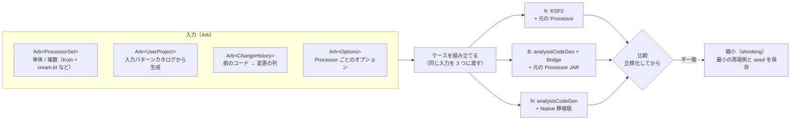
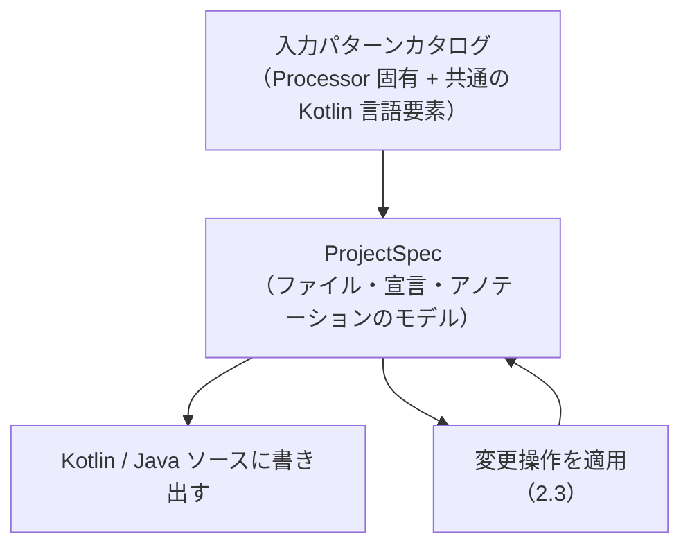
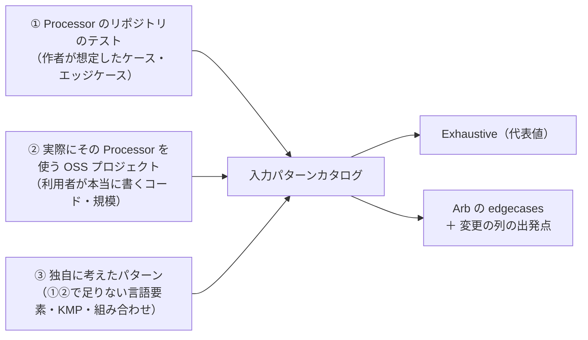
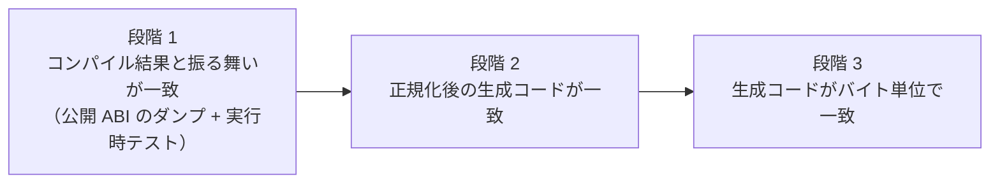
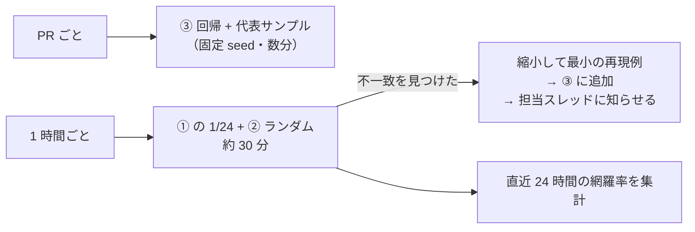

# PBT × E2E 三者差分テストの設計

> 判断したいこと: 実際の利用者が書きうるコード・組み合わせ・設定の「全部」に対して、KSP2 で動かした結果と analysisCodeGen で動かした結果が同じだと、どう確かめるか。

てべすてん の方針（2026-11-25）をそのまま骨組みにした。入力は「Processor の組み合わせ」「利用者が書く入力コードとその変更」「Processor のオプション」の 3 つを Arb で表し、その全組み合わせについて 3 つの実行の出力が一致することを確かめる。

テストケース一覧の対応するケースは `XD-*`（5.29 節）。

## 1. 全体像

- K は基準実装（期待値）。KSP2 と元の Processor をそのまま使う。
- B は「既存の Processor JAR を変更せずに Bridge で動かす」版。
- N は「Native API で書き直した」版。Native 版が無い Processor（Room、および Native 版をまだ作っていない kotlin-inject・Dagger / Hilt）は K と B だけを比べる。
- 増分ビルドでは、さらに「同じ実行系の増分結果」と「最終状態のクリーンビルド結果」を比べる（3 章）。

## 2. 入力の表し方

### 2.1 Arb&lt;ProcessorSet&gt;: Processor の組み合わせ

対象 Processor（スコープ定義書 04 と同じ）: cream.kt・Moshi・Koin Annotations（以上 Native 版が必須）、kotlin-inject・Dagger / Hilt（Native 版は余力があれば。作った場合だけ N と比べ、合格ラインには含めない）、Room（Bridge 版だけ）。Koin はてべすてん が例に挙げた「Koin KSP + cream.kt」の組み合わせを確かめるため、一覧に戻した。

| 次元 | 値 |
|---|---|
| どれを適用するか | 6 個の空でない部分集合 |
| 適用する順番 | 登録順の並べ替え（結果が順番に依存しないことも確かめる） |
| どこに適用するか | 単一モジュール / マルチモジュールの別モジュール / KMP の commonMain・プラットフォーム |

現実的な組み合わせ（必ず含める）: Koin + cream.kt、Moshi + kotlin-inject、Room + Moshi、Hilt + Room + Moshi、Koin + Moshi + cream.kt。

### 2.2 Arb&lt;UserProject&gt;: 利用者が書く入力コード

ランダムな Kotlin を作るのではなく、**「利用者が実際に書くパターン」のカタログ** を P1 でじっくり作り、Arb はカタログの要素を組み合わせてプロジェクトを作る。カタログに無いパターンは生成されないので、カタログの網羅性がそのまま検証の網羅性になる。

- 入力はいったんモデル（`ProjectSpec`）として表し、ソースに書き出す。変更（2.3）もモデルに対して行う。縮小もモデル単位でできる。
- カタログの各パターンには ID（例: `MSH-P-012 デフォルト値付きの nullable プロパティ`）を付け、定期実行（4 章）の直近 24 時間で、全パターンが少なくとも 1 回生成されたかを数える。
- 有効な入力（コンパイルが通るはず）と、わざと誤った入力（Processor がエラーを出すはず）の両方をカタログに入れる。誤った入力では、エラーの出方（ビルド失敗・Logger のエラー）が一致することを確かめる。

> **2026-11-26 更新（ACG-41・ADR-020）**: カタログはリポジトリの `quality/catalog/` に作った（856 パターン、24 次元・206 値、必須 125 値をすべて網羅）。形式・ID・取り込み・状態（candidate / verified / rejected）・kotest からの使い方は ADR-020 と `docs/design/input-pattern-catalog.md`、網羅表は `quality/catalog/coverage.md`。下の初期案と取り込みの説明は経緯として残す。

#### 合成の穴の塞ぎ方（ADR-052、G0 項目 15、ACG-57）

パターンを組み合わせて 1 つのプロジェクトにするときの穴を、次の 3 つで塞ぐ。実装は M2 の XD（XD-04〜10）に着手する前。

| 穴 | 塞ぎ方 | 確かめるケース |
|---|---|---|
| 同じ名前のクラスの衝突 | 合成器がパターンごとに固有のパッケージを割り当て、FQN を含むオプション値や `@ComponentScan` も同じ規則で書き換える | CAT-03 |
| 複数 Processor の相互作用を踏む入力が無い | 同じ宣言に 2 つの注釈、A の生成物を B が読む、などの「組み合わせパターン」をカタログに足す | XD-19 |
| 合成した入力の実行時テストが無い | パターンごとに小さなテストの雛形を持たせ、合成した入力に含まれる雛形を全部走らせる（XD-05 の「実行時テスト」） | XD-05 |

CAT-03・XD-19 は G0 の新ケース案（項目 9）の PR で一覧に足す。

カタログの初期案（P1 で Processor ごとに 1 ファイルずつ詰める）:

| 区分 | パターンの例 |
|---|---|
| 共通の Kotlin 言語要素 | 可視性、パッケージ、ネスト / inner、ジェネリクス（境界・変位・star）、typealias、nullable、value class、sealed、object / companion、デフォルト引数、use-site target 付きアノテーション、Java 混在、複数ファイル / モジュールへの分散、KMP の配置（common / platform、expect / actual） |
| Moshi | `@JsonClass(generateAdapter = true)`、`@Json(name)`、デフォルト値、`@Transient`、ジェネリクスのクラス、private コンストラクタ、ネストしたアダプタ、サポート外の型（エラー） |
| kotlin-inject | `@Inject` コンストラクタ、`@Component`、`@Provides`、スコープ、assisted injection、multibinding（set / map）、親子コンポーネント、循環依存（エラー） |
| Koin Annotations | `@Single` / `@Factory` / `@KoinViewModel`、`@Module` + `@ComponentScan`、qualifier、scope、インターフェースへのバインド、モジュールの include、定義漏れ（エラー） |
| cream.kt | 型変換の宣言、プロパティの対応付け、ネスト・コレクション、KMP の共通生成、対応できない変換（エラー） |
| Room | Entity・DAO・Database、リレーション、TypeConverter、マイグレーション、不正なクエリ（エラー） |
| Dagger / Hilt | Component / Module / Binds / Provides、Subcomponent、Hilt の EntryPoint・AndroidEntryPoint、集約生成、バインド漏れ（エラー） |

#### カタログの 3 つの出所

カタログは次の 3 つを組み合わせて作る（てべすてん の方針、2026-11-26）。

| 出所 | 何が得られるか | 弱いところ | 取り込み方 |
|---|---|---|---|
| ① リポジトリのテスト | 作者が意識したエッジケースと失敗系 | 小さく人工的。実際の書き方の分布とは違う | 下の節 |
| ② 実プロジェクト | 利用者が実際に書くコード、複数 Processor の併用、規模 | エッジケースは少ない。ライセンスの確認が要る | 下の「実プロジェクトから取り込む」 |
| ③ 独自 | ①②に無い Kotlin の言語要素・KMP の配置・Processor の組み合わせ | 書く手間 | 手で書く。①②を取り込んだあと、網羅率の穴（どの言語要素・組み合わせが出てこないか）を見て足す |

#### 既存 Processor のテストから入力を取り込む

カタログを手で作るだけでなく、各 Processor のリポジトリにあるテストの入力コードを取り込んで数を増やす（てべすてん の案、2026-11-26）。2026-11-26 に各リポジトリの既定ブランチを数えた規模感:

| 取り込み元 | 中身 | 規模の目安 |
|---|---|---|
| Moshi | KSP processor のテスト（ソース文字列 → 生成・診断）と、codegen で動かすクラス群の実行時テスト | processor テスト 28 件 + 実行時テスト約 160 件 |
| kotlin-inject | integration-tests（DI の実行時テスト）と compiler/test（失敗・警告・ラウンドのテスト） | 実行時テスト約 130 件 + 失敗系約 100 件 |
| Koin Annotations | 単体テストはほぼ無い。examples 配下のサンプルプロジェクト（coffee-maker、モジュール分割、循環など） | テスト約 15 件 + サンプル 10 個前後 |
| cream.kt | cream-ksp のテスト（facet 形式の Markdown golden）と test モジュール | テストのソース約 235 本 + golden 約 1,300 個 |
| Dagger / Hilt | javatests のうち KSP バックエンドでも回るもの | テストは全体で約 2,200 件。Kotlin ソースを使うファイルは約 100 本 |
| KSP 本体 | `kotlin-analysis-api/testData`（KSPT としても使う） | 144 件 |
| Room | 未調査（P1 で数える） | |

取り込み方:

1. テストの入力（ソース文字列やテスト用のソースファイル）だけを抜き出し、カタログのパターンとして ID を付ける（例: `MSH-T-031`）。出所（リポジトリ・パス・コミット）を一緒に記録する。全部 Apache License 2.0 なので、出所の表示と NOTICE を LIC-01 と同じ仕組みで管理する。
2. 期待値は元のテストのアサーションではなく、K（KSP2）の出力を使う。元のテストのアサーション（実行時の振る舞い、エラーになるか）は、追加の検証として残す。
3. 失敗系のテスト（コンパイルエラーや Processor のエラーを確かめるもの）は「わざと誤った入力」としてカタログに入れる。
4. 取り込んだ入力は、kotest の `Exhaustive` に代表値として登録し、同じ値を `Arb` の edgecases にも登録する。さらに変更の列（2.3）の開始点にも使い、「既存のテストコードに手が入った」状態も試す。
5. 取り込みはスクリプトで行い、Processor のバージョンを上げたら取り込み直す。

これで、①だけで 1,000 件前後が加わる見込み（②と③は別に数える）。件数が増えるため、PR ごとの固定再生は代表の一部にとどめ、全件は 1 時間ごとの定期実行で回す（4 章）。Koin は取り込める量が少ないので、手作りのカタログで補う。

#### 実プロジェクトから取り込む

- **選び方**: Processor ごとに 3〜5 個。GitHub のコード検索でその Processor を `ksp(...)` で使っている公開プロジェクトを探し、ライセンスが Apache 2.0 / MIT などの寛容なもの、最近も更新されているもの、規模がばらけるもの（小さなサンプル〜大きなアプリ）、KMP のもの（Koin・kotlin-inject・cream.kt）を選ぶ。複数の Processor を併用しているプロジェクト（例: Hilt + Room + Moshi）を優先する。
- **選んだ候補**: ADR-019 の 3 節（15 プロジェクト、Apache-2.0 / MIT、コミット固定）。cream.kt は外部の利用プロジェクトが無いため、cream.kt の `test` モジュールで代える
- **使い方は 2 通り**: (a) プロジェクト丸ごとをコミット固定で E2E のフィクスチャにし、K / B / N でビルドして比べる（性能の Large Project 計測にも使う）。(b) Processor のアノテーションが付いた宣言とその依存を抜き出し、カタログのパターンとして ID を付ける（例: `KOI-R-007`）。
- **記録**: 出所（リポジトリ・コミット・ライセンス）を残す。ライセンスが合わないものは使わない。
- **入れ替え**: 一覧は P1 で決めて固定する。入れ替えるときは理由を残す。

### 2.3 Arb&lt;ChangeHistory&gt;: 前のコード → 変更

増分ビルドの入力は「最初のプロジェクト」と「変更の列」の組。状態機械の PBT として、各ステップでビルドし、毎回比較する。

| 変更操作 | 例 |
|---|---|
| 宣言の追加・削除・リネーム | `@Single` のクラスを 1 つ足す |
| アノテーションの付け外し・引数の変更 | `@Json(name = "a")` → `"b"` |
| 型の変更 | プロパティを `String` → `String?` |
| 関数本体だけの変更 | ABI は変わらない変更 |
| ファイルの追加・削除・移動 | 別パッケージへ移す |
| 依存の変更 | モジュール間の依存を足す、ライブラリのバージョンを変える |
| オプションの変更 | Processor のオプションを切り替える |
| Processor の付け外し | 組み合わせに 1 つ足す / 外す |

### 2.4 Arb&lt;Options&gt;: Processor のオプション

各 Processor のドキュメントとソースから、オプションを「名前・型・取りうる値」の表にする（P1）。真偽値や列挙のような小さい値域は全値、文字列や数値は代表値と境界値にする。

## 3. 何を比べるか（出力と比較の強さ）

### 3.1 比べる出力

| 出力 | 比べ方 | K ↔ B | K ↔ N |
|---|---|---|---|
| 生成コード（Kotlin / Java） | 正規化（3.3）してから比べる | 一致が必須 | 3.2 の段階 |
| 生成リソース（`META-INF` など） | 同上 | 一致が必須 | 一致が必須 |
| ビルドの成否とコンパイラ診断 | 成否・診断の位置と種類 | 一致が必須 | 一致が必須 |
| 生成コードの振る舞い | Processor ごとの実行時テスト（JSON の往復、DI で取れるインスタンスなど）を同じ入力で走らせる | 一致が必須 | 一致が必須 |
| Logger 出力 | レベル・位置・文言を正規化して比べる | M2 は計測して表示、M3 で一致が必須 | レベルと位置は M3 で必須、文言は努力目標 |
| ラウンドの挙動 | ラウンド数と各ラウンドの生成ファイル | M3 で一致が必須 | 比べない |
| 増分の結果 | 増分ビルド結果 = 同じ実行系での最終状態のクリーンビルド結果 | 各実行系で必須 | 各実行系で必須 |

### 3.2 Native 版の比較の強さ（段階）

Native 版は書き直しなので、生成コードが一字一句同じとは限らない。比較の強さを 3 段階に分け、マイルストーンごとに求める段階を上げる。

- **M2: 段階 1 が必須。** 生成された宣言の公開 ABI（binary-compatibility-validator のダンプ）と、実行時テストの結果が K と一致する。
- **M3: 段階 2 が必須。** Native 版は「解析部分だけを AA に置き換え、コード生成部分（KotlinPoet での組み立て）は元の Processor から流用する」方針で移植する。そうすれば正規化後の一致は届く範囲にある。どうしても差が出る箇所は、差の内容と理由を ADR に書き、許容リストに載せたものだけ認める。
- 段階 3 は計測して表示するだけ。

### 3.3 正規化

比べる前に、本質的でない差を消す。正規化の規則自体も Unit テストで確かめる（XD-16）。

- 出力ルートと絶対パス → 相対パスにする
- ファイルの列挙順 → パスで並べる
- 改行と末尾の空白 → LF に揃える
- 生成日時やバージョン文字列などの埋め込み → プレースホルダにする（Processor ごとに規則を書く）
- Logger の位置 → `相対パス:行` にする

## 4. 「全組み合わせ」をどう扱うか

入力空間は無限なので、文字どおりの全組み合わせは回せない。**決定的に網羅する層** と **ランダムに広げる層** の 2 段で、「カタログのパターン・オプション値・Processor の組」に漏れがないことを数字で示す。

| 層 | 中身 | いつ回すか |
|---|---|---|
| ① 決定的な網羅 | Processor は単体の全部と 2 個の全ペア（順番の入れ替えを含む）。オプションは全ペア網羅（pairwise の covering array）。カタログの全パターンを少なくとも 1 回 | 1 時間ごとの定期実行。全体を分割し、24 時間で一巡させる |
| ② ランダム | Arb で上の次元をまとめて生成。境界値を出やすくし、サイズを段階的に大きくする | 1 時間ごとの定期実行。毎回新しい seed |
| ③ 回帰・代表 | 過去に失敗した seed と縮小した最小の再現例、および Processor ごとの代表的な入力（固定 seed）。ランダムではなく固定の入力として再生する | PR ごと（通常のテストとして、数分） |

網羅率（直近 24 時間の定期実行をまとめて計測し、進捗 Artifact に出す）:

- カタログのパターンの網羅率: **100% が必須**
- オプション値の網羅率と、オプション値の組の網羅率: **100% が必須**
- Processor のペアの網羅率: **100% が必須**

実行の仕方（てべすてん の方針、2026-11-25）: PBT × E2E は時間がかかるので、PR ごとには回さない。**1 時間ごとに定期実行し、変なケースが出ていないかを見張る。** 1 回の実行時間は 30 分前後に収める。

- **30 分に合わせる調整**: 1 試行あたりの時間を毎回計測し、次の実行の試行数を自動で決める（目標 30 分、上限 40 分で打ち切り）。① は 24 分割し、1 回の実行で 1 区画を回す。残り時間で ② を回す。
- **K の結果のキャッシュ**: K（KSP2）は基準実装で毎回同じ結果になるので、「入力のハッシュ → 出力」でキャッシュし、同じ入力を何度も走らせない（キャッシュの正しさは XD-17）。
- **重い入力を毎時間に寄せすぎない**: KMP（mac が必要）や Android の入力は、全体の中で決めた割合だけ混ぜる。mac ランナーは数時間に 1 回の実行に限ってもよい（ADR で決める）。
- **見つけたとき**: 不一致は縮小して最小の再現例にし、seed と一緒に ③ の回帰ケースとして保存する。以後は PR ごとに再生されるので、直すまで CI が落ちる。
- **通過の判定**: PBT のケース（種別 P と XD の差分ケース）は、「直近 24 時間の定期実行で一度も不一致が出ていない」ことを通過とする（通常のテストの「直近 3 回の CI で成功」の代わり）。
- **Kotlin バージョン**: 対応する全バージョン（2.4.0 以降の全 stable + 最新のプレリリース）を 1 時間ごとの実行で順に入れ替え、24 時間で一巡させる。K の結果のキャッシュはバージョンごとに分ける。
- **数値の見直し**: 上の具体値（1 時間ごと、30 分前後、上限 40 分、24 分割）は仮の値。定期チェック（サポート AI Agent）が、実行時間の実績・24 時間の網羅率・反例の見つかり方・CI 費用を見て適切か確かめ、調整する（てべすてん の依頼、2026-11-26）。変えたらこの節を直し、理由を残す。
- **費用**: 1 時間ごとに 30 分の CI が回る（1 日 12 時間ぶん）。GitHub Actions の利用時間がかさむので、費用の上限（計画書 14 のコスト行）を決めるときに入れておく。

## 5. 作るもの（P1 の作業）

| 作るもの | 中身 |
|---|---|
| 入力パターンカタログ | Processor ごと + 共通 Kotlin 言語要素の 1 ファイルずつ。パターン ID 付き。**これ自体を てべすてん のレビュー対象にする**（問題空間そのものなので） |
| オプション表 | Processor ごとのオプションの名前・型・値域 |
| `ProjectSpec` と書き出し器 | 入力のモデルと、Kotlin / Java ソースへの書き出し |
| Arb 群 | kotest-property を使う。ProcessorSet / UserProject / ChangeHistory / Options |
| 3 実行系のランナー | K / B / N を同じ入力で Gradle TestKit から動かし、出力を集める |
| 比較器と正規化 | 3 章の比較・正規化と、差分の読みやすい表示 |
| 網羅率の計測 | カタログ・オプション・ペアの網羅率を出す |

これらのテストも、他のケースと同じく GO 前にテストコードとして書いて保留（skip）にしておく。

## 6. レビューで判断してほしいこと

1. Native 版の比較の強さ: M2 は段階 1（ABI + 振る舞い）、M3 は段階 2（正規化後の一致）を必須にしたこと。そのために Native 版はコード生成部分を元の Processor から流用する方針にしたこと。
2. Logger の一致: K ↔ B は M3 で必須、K ↔ N は文言を努力目標にしたこと。
3. 「全組み合わせ」を、決定的な網羅（全ペア + カタログ全パターン）とランダムの 2 段で扱い、網羅率 100% を合格条件にしたこと。1 時間ごと・約 30 分の定期実行で回し、24 時間で一巡させること。3 個以上の組み合わせは現実的な組み合わせとランダムに任せている。
4. 入力パターンカタログを、テストケース一覧とは別のレビュー対象にすること。既存 Processor のテストから取り込む分（2.2 節）は、取り込みの規則だけをレビューし、1 件ずつは見ない想定。
5. Koin Annotations を対象に戻したこと（Native 版も作る）。
