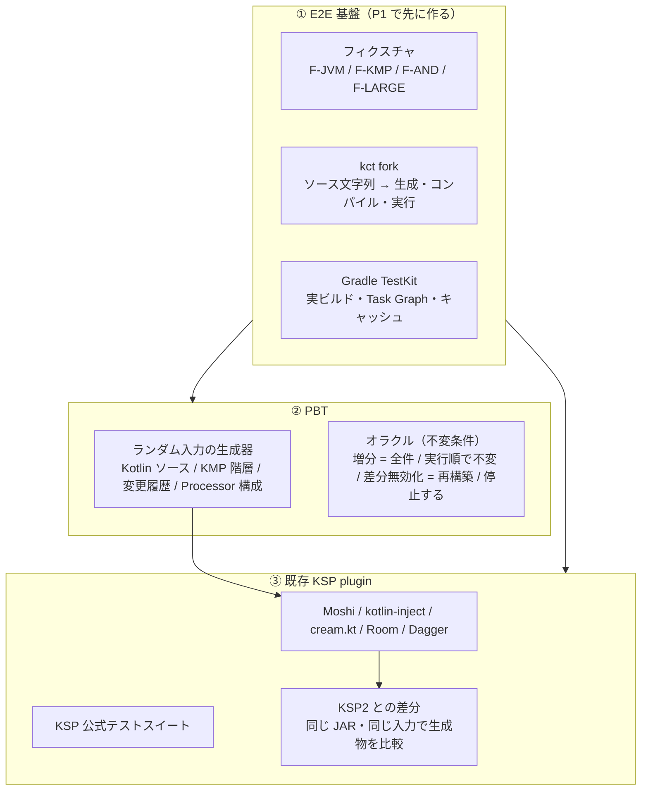
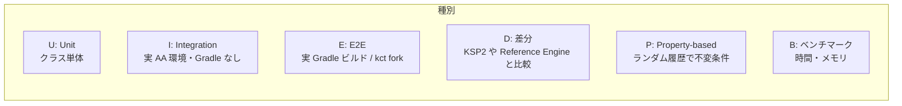
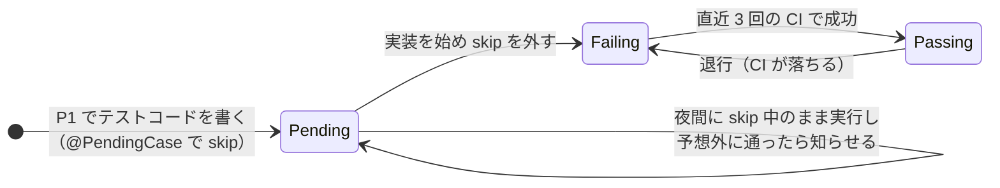

# テストケース一覧

> 判断したいこと: analysisCodeGen が最終的に何を満たせば「できた」と言えるか。M1〜M3 でどこまで通っていればよいか。

この一覧は、品質の合格ラインと進捗の物差しを兼ねる。観点は設計文書 15.4 を軸に、Processor API・AA ネイティブ解析・実用 Processor・テストフレームワーク・ドキュメントなど、15.4 に無いが成果物（スコープ定義書 04）に含まれるものを足した。

細かい仕様（停止条件の値、除外規則など）は設計文書で未確定のものが多い。そこは「ADR どおり」と書き、実装 AI Agent が決めて ADR に残す前提にしている。

## 0. レビューで判断してほしいこと

1. 合格ラインを「担当ケース 100%」にしたこと（割合にしない）。
2. 実用 Processor の選定（cream.kt・Moshi・Koin は Native 版も必須、kotlin-inject と Dagger / Hilt の Native 版は任意、Room は Bridge 版だけ）と、それぞれを M のどこに置いたか。
3. M1 の範囲。G0 で「範囲を文章で決め、付け直す」に決まった（3 章「M1 の範囲」、ADR-056）。
4. 性能の基準（KSP2 比 100% 以下、中央値 10 回、75% は表示のみ）。
5. Windows（GRD-30）と Isolated Projects（GCC-05）を M3 に入れたこと。
6. 検証の 3 本柱（E2E 基盤・PBT・既存 KSP plugin）の組み方と、PBT を 1 時間ごと・約 30 分で回すこと（1 章）。
7. 全ケースを GO 前にテストコード化して skip しておく進め方の細部: U / I は内部 API の呼び出し部分だけ実装時に埋めること、一度外した skip は付け直さないこと（3 章）。
8. PBT × E2E の三者差分テスト（KSP2 / Bridge / Native の出力一致）の設計。詳細と論点は [pbt-differential-design.md](pbt-differential-design.md) の 6 章。
9. 対応 Kotlin バージョン（2.4.0 以降の全 stable + 最新プレリリース）を M1 は最新 stable、M2 は全 stable、M3 はプレリリースまで、と段階的に求めること（3 章）。

## 1. 検証の 3 本柱

てべすてん の方針（E2E 基盤を作る、PBT と既存 KSP plugin を活用する）に沿って、ケースの確かめ方を 3 つの柱に寄せる。Unit / Integration は柱を支える部品の検査として書く。

| 柱 | 何を確かめるか | 主なケース |
|---|---|---|
| ① E2E 基盤 | 実際の Gradle ビルドと kct fork で、生成・コンパイル・実行まで通ること。利用者にも同じ基盤を提供する | GRD・KMP・RND・FAIL・GCC・TST の E |
| ② PBT | 手で書いた例では漏れる組み合わせ。生成器でランダムな入力を作り、不変条件が崩れたら縮小（shrinking）して最小の再現例を残す | INC-14、DET-02、CCH-05、BINC-04、MIX-06、HYB-05、PBT-*、XD-* |
| ③ 既存 KSP plugin | 実用ワークロードでの正しさと互換性。KSP2 を基準実装として、同じ Processor JAR・同じ入力の生成物・診断・時間を比べる | BRG・BIN・BKMP・RW・KSPT・PERF |

②と③は組み合わせる（**三者差分テスト**）: Processor の組み合わせ・利用者が書く入力コードとその変更・Processor のオプションを Arb で表し、その組み合わせごとに KSP2 / Bridge / Native 移植版の 3 つで動かして出力（生成コード・リソース・診断・振る舞い・Logger）が一致することを確かめる。設計は [pbt-differential-design.md](pbt-differential-design.md)、ケースは XD-*（5.29）。

PBT の回し方（てべすてん の方針）: PR ごとには回さず、1 時間ごとに定期実行する。1 回は 30 分前後になるよう試行数を自動で調整する。見つけた失敗は縮小して seed ごと回帰テストとして固定し、こちらは PR ごとに再生する。詳しくは [pbt-differential-design.md](pbt-differential-design.md) の 4 章。

E2E 基盤（kct fork・フィクスチャ・TestKit 補助・ケース ID の集計スクリプト）は GO 前の P1 で作る。そのうえで全ケースのテストコードを P1 のうちに書き、skip 状態で置いておく（3 章）。

## 2. 読み方

| 列 | 意味 |
|---|---|
| ID | `観点-連番`。テストコードにこの ID を付ける（下の「判定方法」） |
| ケース | 期待する結果まで書く。「動く」ではなく何が一致・成功・検出されるか |
| 種別 | U / I / E / D / P / B（上の図）。E2E を重視するため、同じ内容を I でも書ける場合も E を正とする |
| M | このケースが通っていなければならない最初のマイルストーン（M1 / M2 / M3）。「任意」は余力があれば作るもので、合格ラインに含めない |
| 備考 | `mac` = macOS ランナーが必要（Apple ターゲット）。使うフィクスチャなど |

## 3. 合格ラインと判定方法（決め打ち）

### 合格ライン

| マイルストーン | 合格ライン |
|---|---|
| M1: 最小限動く | M1 のケースが **100%** 通過 |
| M2: 性能込みで高品質 | M1 + M2 のケースが **100%** 通過（M1 分の退行なし） |
| M3: KSP 互換 | M1 + M2 + M3 のケースが **100%** 通過（全件） |

割合（「8 割通れば OK」）にしない理由: 割合だと難しいケースを後回しにしたまま合格できてしまい、目安の日数に引っ張られて品質が下がる。代わりに、各ケースに「いつまでに通るべきか」を前もって付けておく。

### M1 の範囲（ADR-056、G0 項目 2）

M1 は「手元で何が試せるか」で決める。件数から決めない。

| 対象 | M1 に入れる | M2 以降に回す |
|---|---|---|
| JVM | 単一モジュール・複数モジュール | — |
| KMP | commonMain + 1 プラットフォーム（JVM） | 中間 SourceSet・iOS・プラットフォームごとの集約（KMP-05・06・13・21） |
| Android | 1 Variant（boot classpath を含む） | 4 Variant（GRD-11。Variant API の GRD-14 と揃える） |
| 既存 Processor | Bridge の happy path（RW-*-B1・RW-CMB-01） | Native 版は cream.kt だけ M1。Moshi・Koin の Native 版（RW-MSH-N1・RW-KOI-N1）は M2 |
| 後戻りしにくい制約 | 最小のスモーク（GRD-21 Worker 分離・GCC-01 Configuration Cache・MEM-01 Disposer） | — |

あわせて、M1 のケースが M2 のケースを前提にしていたずれを直した。RW-*-B1 が前提にする BRG-09 を M1 に、KSPT の振り分けを「Java を含むか」優先から「基本かどうか」優先に改めた（6 章）。

### テストコードの先行作成と skip 解除（てべすてん の方針）

実装を始める前に、全ケースをテストコードとして書いておき、すべて skip 状態にする。実装ができたら 1 件ずつ skip を外す。

- **P1（GO 前）に全ケースのテストコードを書く。** 1 ケース 1 本以上。テストには期待する結果（アサーション）まで書き、`case("INC-14", "…", pending = PendingCase(Milestone.M2)) { … }` の形（FreeSpec の DSL 引数。ADR-030、使い方は `.claude/rules/test-cases.md`）で skip する（計画書 14 の「E2E テストの先行準備と保留の外し方」と同じ規則）。理由は「未実装」と「ADR 付き（ADR 番号を書く）」の 2 種類だけ。
- E / D / P / B は、フィクスチャのビルドスクリプトと公開 API・Gradle DSL（ドキュメントサイトで決めたもの）だけで書けるので、最終形で書く。U / I は内部 API が決まっていないため、P1 では入力・期待結果・検証手順をコードとして書き、内部 API の呼び出し部分は実装時に埋める。
- フィクスチャ（4 章）とテスト用 Processor も P1 で作る。
- 一覧と実コードのずれは CI で止める: `test-cases.csv` にあるのにテストが無いケース、テストにあるのに一覧に無い ID があれば CI が落ちる。

### 対応 Kotlin バージョンと判定（てべすてん の方針、2026-11-26）

Kotlin は 1 つに固定しない。**2.4.0 以降のすべての stable と、その時点で最新のプレリリース（RC / beta / alpha のどれか 1 つ）** に対応する。ケースの「通過」は、そのマイルストーンで求めるバージョンすべてで通ることとする。

| マイルストーン | 通過を求める Kotlin バージョン |
|---|---|
| M1 | 最新の stable |
| M2 | 2.4.0 以降のすべての stable |
| M3 | 2.4.0 以降のすべての stable + 最新のプレリリース |

- CI: PR ごとは最新 stable と 2.4.0（最古）の 2 つ。全バージョンのマトリクスは定期実行で回す。
- 新しいバージョンが出たら一覧に自動で入り（VER-04）、そのバージョンで落ちるケースは Failing になる。対応しきるまで合格ラインは満たさない。
- PBT × E2E は 1 時間ごとの実行で、区画 = 時 % 24、版 = (時 + 日) % 版の数 で割り当てる。1 日ずつずらすので、版の数 × 24 時間（5 版なら 5 日）で「全版 × 全区画」が一巡する。網羅率は版ごとに独立に数える（ADR-055、G0 項目 13）。

### 判定方法

- ケースの状態は **Pending（skip 中）/ Failing / Passing** の 3 つ。Pending かどうかは `quality/case-status.csv`（テストを実行せずに宣言から生成し、`:quality:checkCaseIds` が最新かを検査する）、Failing / Passing は CI の JUnit XML（テスト名の先頭が `[ID]`）から集計スクリプトが出す。
- Passing とは、skip を外したうえで main ブランチの CI で直近 3 回続けて成功していること。途中で落ちたことがある（flaky）ものは Passing に数えない。
- skip を外したテストが落ちたら CI は失敗する（Pending 以外の失敗は許さない）。
- P（PBT）と XD の差分ケースは、最新 stable では直近 24 時間、その他の版ではその版の一巡（版の数 × 24 時間）の定期実行で、一度も失敗していないことを通過とする（1 時間ごとに回すため、上の「直近 3 回」の代わり。ADR-055）。未実行・障害の回は網羅にも通過にも数えない。
- B（ベンチマーク）は、ケースに書いた基準（例: KSP2 比 100% 以下）を、ウォームアップ後 10 回計測の中央値で満たしたら通過。
- 進捗 = Passing の件数。進捗 Artifact には、マイルストーンごとの Passing 率、Pending / Failing の件数、種別ごと（特に E/D/P）の Passing 率を出す。

### R-01 の 2 つの例外（ADR-053、G0 項目 7）

- **① ADR 未確定**: 期待値が「ADR どおり」で、その ADR がまだ無いケース（ANA-09・HYB-02・HYB-04・KMP-22 など）は、ADR が確定したときに 1 回だけアサーションを書いてよい。書いた後は R-01 に従う。DEF-03・DEF-04・OUT-05 は ADR-014 で決まっているので、ケースの文面を具体的に直して閉じた
- **② 呼び出し未接続**: 内部 API の呼び出しを仮の実装で代用している U / I のテストは、進捗表で「未接続」として別に数え、「テストがある」に入れない。2026-11-27 時点で該当は 0 件（全 U / I が実 API を呼んでコンパイルが通る）

### 一覧とテストの変え方（品質を落とさないための規則）

| 変更 | 可否 |
|---|---|
| ケースの追加 | いつでも可。見つけたら一覧とテスト（Pending）を同時に足す。M は内容で決める |
| skip を外す | 実装したらいつでも。外す PR でアサーション（期待する結果）を変えない |
| 一度外した skip を付け直す | 不可。退行は直す（リスク R-01） |
| Pending のテストの期待結果を変える・弱める | 仕様が変わった場合だけ。ADR に理由を書き、てべすてん に知らせる |
| 期待値が「ADR どおり」で ADR が未確定のケースのアサーションを書く | 例外 ①。ADR が確定したときに 1 回だけ書いてよい。以後は R-01 |
| ケースの削除・M を後ろへずらす | 仕様が変わった・前提が誤っていた場合だけ。ADR + 報告。**日数に間に合わせるための削除・後ろ倒しはしない** |
| ケースの内容を細かく分ける | 可。分けたものは元の ID に `a`, `b` を付ける |

## 4. 共通フィクスチャ

テストで繰り返し使うサンプルプロジェクトとテスト用 Processor。サンプルはドキュメントの Quick start にも使う。

| 名前 | 内容 |
|---|---|
| F-JVM | Kotlin/JVM 単一モジュール（main + test） |
| F-JVM-MULTI | `:lib` と `:app` のマルチモジュール |
| F-JAVA | Kotlin + Java 混在 |
| F-KMP | commonMain, jvm, android, iosArm64, iosSimulatorArm64, linuxX64, js(IR), wasmJs。デフォルト階層テンプレート |
| F-KMP-CUSTOM | `dependsOn` を手で組んだ階層 |
| F-AND | Android アプリ + ライブラリ。debug/release × free/paid の 4 Variant、unit test と androidTest あり |
| F-LARGE | スクリプトで作る大規模プロジェクト（1,000 ファイル版と 5,000 ファイル + 依存 300 個版） |
| TP-Mapper | ファイル単位（isolating）でクラスごとに Mapper を作る |
| TP-Registry | SourceSet 全体を集約して Registry を作る（`includeNewFiles = true`） |
| TP-Chain | 生成したコードに次のラウンド用のアノテーションを付け、N 段連鎖させる |
| TP-Actual | `expect` から各プラットフォームの `actual` を作る |
| TP-Body | 関数本体を解析して呼び出しグラフを生成する（AA ならではの解析） |
| TP-Defer | 生成されるはずの型が見つかるまで defer する |
| TP-Bad | わざと壊れた振る舞いをする（無限ラウンド、重複出力、例外、出力先外への書き込み） |
| TP-Resource | Kotlin 以外（Java ソース、リソース）を生成する |

## 5. テストケース

### 5.1 Gradle / KGP / AGP 統合（GRD）

| ID | ケース | 種別 | M | 備考 |
|---|---|---|---|---|
| GRD-01 | JVM 単一モジュールに plugin を適用すると `analysisCodeGenMainSourceSet` / `analysisCodeGenTestSourceSet` が登録され、生成物込みで `build` が成功する | E | M1 | F-JVM |
| GRD-02 | 生成物が `build/generated/analysisCodeGen/<SourceSet>/{kotlin,java,resources}` に出力され、他のタスクと同じディレクトリに書かない | E | M1 | |
| GRD-03 | Task Graph 上で compile タスクが analysisCodeGen タスクに依存し、自タスクの出力が自タスクの入力に入らない（循環なし） | E | M1 | |
| GRD-04 | 生成ディレクトリが IDE 向けのソースルートにも登録される（Tooling API で取得したモデルに含まれる） | E | M2 | |
| GRD-05 | AA に渡すライブラリ集合が、その SourceSet / Compilation のコンパイルクラスパスと一致する | E | M1 | |
| GRD-06 | languageVersion / apiVersion / opt-in / `-X` 言語機能フラグ / explicitApi が解析に反映される（例: context parameters を使うソースが解析エラーにならない） | E | M2 | |
| GRD-07 | JDK Toolchain の指定（17 / 21）に従って JDK の API が解決される（17 指定時に 21 専用 API は未解決） | E | M2 | |
| GRD-08 | Kotlin + Java 混在で、Kotlin から参照する Java クラスが解析で解決される | E | M1 | F-JAVA |
| GRD-09 | マルチモジュールで `:app` の Processor が `:lib` の公開宣言を解析できる | E | M1 | F-JVM-MULTI |
| GRD-10 | `:lib` の生成物（コンパイル済み）が `:app` から参照できる | E | M1 | F-JVM-MULTI |
| GRD-11 | Android アプリで 4 Variant それぞれにタスクが登録され、Variant 固有のソース（`src/free/` など）が解析される | E | M2 | F-AND |
| GRD-12 | Android の boot classpath（android.jar）が解析に入り、`android.*` の型が解決される | E | M1 | F-AND |
| GRD-13 | Android の unit test / androidTest の Compilation にも生成でき、main の生成物がテストから見える | E | M2 | F-AND |
| GRD-14 | AGP の Variant API（`androidComponents.onVariants`）経由で生成ソースが登録される | E | M2 | F-AND |
| GRD-15 | AGP の KMP 用 Android plugin（`com.android.kotlin.multiplatform.library`）で生成・ビルドできる | E | M2 | |
| GRD-16 | JVM の test SourceSet 向けに別タスクが走り、main の生成物が test から見える | E | M1 | F-JVM |
| GRD-17 | Processor を `analysisCodeGen(...)` 依存と SourceSet DSL の `processor(...)` のどちらで指定しても解決・実行される | E | M1 | |
| GRD-18 | `sourceSets.all` / `compilations.all` の一括登録が効き、個別指定と重なったときの優先順位が ADR どおり | E | M2 | |
| GRD-19 | Processor オプションのグローバル指定と SourceSet スコープ指定が渡り、スコープ側が優先される | E | M1 | |
| GRD-20 | Processor が別バージョンの依存（例: Guava、kotlinx-serialization）を持っても、ビルドや AA と衝突しない（ClassLoader 分離） | E | M2 | |
| GRD-21 | AA / IntelliJ Platform がビルドスクリプトの classpath に載らない（Worker 側だけで読み込まれる） | E | M1 | |
| GRD-22 | 遅延設定: `help` だけを実行したとき analysisCodeGen タスクが realize されない | E | M2 | |
| GRD-23 | 同じモジュールで KSP と併用でき、タスクの循環が起きず、生成物の可視性が ADR で決めた規則どおり | E | M2 | |
| GRD-24 | 対応表の最小と最新の Gradle でビルドが通る | E | M2 | |
| GRD-25 | `--parallel` のマルチモジュールで同時実行しても結果が壊れない | E | M2 | |
| GRD-26 | Composite build（`includeBuild`）で開発中の Processor を使える | E | M2 | |
| GRD-27 | Processor を指定していない SourceSet ではタスクが実行されない（登録しないか NO-SOURCE） | E | M1 | |
| GRD-28 | Kotlin plugin が無いプロジェクトに適用したら、原因が分かるエラーで失敗する | E | M1 | |
| GRD-29 | Worker のヒープ上限など実行設定を DSL で変えられ、反映される | E | M2 | |
| GRD-30 | Windows 上で F-JVM がビルドでき、生成物のパスと内容が Linux と一致する | E | M3 | Windows ランナー |

### 5.2 KMP の整合性（KMP）

| ID | ケース | 種別 | M | 備考 |
|---|---|---|---|---|
| KMP-01 | commonMain の Processor が commonMain に 1 回だけ生成し、全ターゲットの Compilation から参照してビルドが通る | E | M1 | F-KMP |
| KMP-02 | commonMain の生成物がプラットフォームごとに再生成されない（生成ファイル数と宣言の重複が 0） | E | M1 | |
| KMP-03 | `expect` から各プラットフォームに `actual` を生成し、全ターゲットでコンパイルが通る | E | M1 | TP-Actual |
| KMP-04 | 同じモジュールで commonMain と jvmMain に別々の Processor を付け、それぞれ自分の own files だけを処理する | E | M1 | |
| KMP-05 | 中間 SourceSet（iosMain / appleMain / nativeMain）に生成し、iosArm64Main・iosSimulatorArm64Main から参照できる | E | M2 | mac |
| KMP-06 | 解析の可視範囲が正しい: commonMain から `java.*` は解決できず、iosMain から `platform.UIKit` は解決でき JVM API は解決できない | E | M2 | mac |
| KMP-07 | commonMain の解析で共通 metadata 依存（kotlinx-coroutines-core の common 部分）が解決される | E | M1 | |
| KMP-08 | 中間 SourceSet で commonize されたプラットフォームライブラリ（`platform.posix` など）が解決される | E | M2 | |
| KMP-09 | jvmMain の実行で、commonMain の宣言は visibleFiles に入り ownFiles には入らない | I | M1 | |
| KMP-10 | Processing Scope を明示的に広げると上流（commonMain の expect）を処理できるが、出力先は jvmMain のまま | I | M1 | |
| KMP-11 | commonMain の生成物を jvmMain の Processor が解析できる | E | M1 | |
| KMP-12 | 1 つの SourceSet が複数の Compilation に属するとき、Compilation 単位の実行ではそれぞれのクラスパス・プラットフォームで解析される | E | M2 | |
| KMP-13 | `compilations.all` の Processor がプラットフォームごとに別々の集約出力（DI Registry 相当）を作る | E | M2 | TP-Registry |
| KMP-14 | commonTest / jvmTest でも生成でき、main の生成物がテストから見える | E | M2 | |
| KMP-15 | テストからの friend 依存: commonTest の解析で commonMain の `internal` が解決される | I | M2 | |
| KMP-16 | jvmMain の解析で `expect` 宣言から対応する `actual` を AA で辿れる | I | M2 | |
| KMP-17 | デフォルト階層テンプレートと手で組んだ `dependsOn` 階層の両方で KMP-01〜05 が通る | E | M2 | F-KMP-CUSTOM |
| KMP-18 | 全ターゲット（jvm, android, iosArm64, iosSimulatorArm64, macosArm64, linuxX64, mingwX64, js(IR), wasmJs）で生成とコンパイルが通る | E | M2 | mac |
| KMP-19 | KMP の androidMain で Build Variant ごとに生成できる | E | M2 | |
| KMP-20 | KMP モジュール `:shared` を Android の `:app` が使い、`:shared` の commonMain 生成物が見える | E | M2 | |
| KMP-21 | iosMain だけに Processor を付けたとき、他の Compilation のタスクや出力に影響しない | E | M2 | |
| KMP-22 | Linux 上で Apple 向け SourceSet の解析ができる。できない構成では、原因が分かる診断が出る | E | M2 | |
| KMP-23 | SourceSet / Compilation 名からタスク名を作る規則が一意（`analysisCodeGenIosArm64MainSourceSet` など、衝突しない） | U | M1 | |
| KMP-24 | KSP の Issue #965 / #2621 の再現シナリオで、共通の生成物が 1 回だけ作られ下流から見える | E | M1 | 回帰テスト |
| KMP-25 | IDE のインポートで、KMP の各 SourceSet に生成ディレクトリが登録される | E | M2 | |

### 5.3 Native Processor API（API）

| ID | ケース | 種別 | M | 備考 |
|---|---|---|---|---|
| API-01 | ServiceLoader で `AnalysisCodegenProcessorProvider` が見つかり、Processor が生成される | I | M1 | |
| API-02 | 複数の Processor が同じラウンドで全部実行される | I | M1 | |
| API-03 | オプションが Provider と RoundContext に渡る | I | M1 | |
| API-04 | logger の error でビルドが失敗し、ファイル名と行番号付きでビルド出力に出る。warn / info も出る | E | M1 | |
| API-05 | CodeGenerator で Kotlin・Java・リソース（`META-INF/services` など）を生成でき、パッケージとパスが一致する | I | M1 | TP-Resource |
| API-06 | 出力ルートの外（`../`、絶対パス）への書き込みが拒否される | U | M1 | |
| API-07 | RoundContext の round / allFiles / newFiles / changedFiles が定義どおりの集合になる | I | M1 | |
| API-08 | SourceSetContext の name / platform / ownFiles / visibleFiles / dependencies / module が正しい | I | M1 | |
| API-09 | `finish()` は全ラウンド後に 1 回だけ、`onError()` はエラー時だけ呼ばれる | I | M1 | |
| API-10 | Processor から解析環境を書き換える操作をすると、原因が分かる例外になる（Processor には読み取りだけを公開） | I | M2 | |
| API-11 | Provider や Processor が例外を投げたら、Processor 名とスタックトレース付きでビルドが失敗する | I | M1 | |
| API-12 | Processor インスタンスが実行単位の間で同じもの（ラウンドごとに作り直されない） | I | M1 | |
| API-13 | 生成ファイルの文字コードが UTF-8、改行が LF に固定される | U | M1 | |
| API-14 | Native と KSP の Provider を両方含む JAR で、ADR で決めた規則どおりに片方だけ実行される（二重実行しない） | I | M2 | |
| API-15 | 公開 API の互換性を API dump（binary-compatibility-validator）で検査し、意図しない変更で CI が落ちる | U | M2 | |

### 5.4 AA ネイティブな解析能力（ANA）

KSP では難しく、analysisCodeGen の存在理由にあたる部分。

| ID | ケース | 種別 | M | 備考 |
|---|---|---|---|---|
| ANA-01 | 関数本体の式と呼び出し先を解決して呼び出しグラフを生成し、生成物がコンパイル・実行できる | E | M1 | TP-Body |
| ANA-02 | ライブラリ（JAR / klib）の宣言と型を解決できる | I | M1 | |
| ANA-03 | Java ソースの宣言を `KaSymbol` として扱える | I | M1 | F-JAVA |
| ANA-04 | ジェネリクス・型エイリアス・nullable・star projection・関数型を解決できる | I | M1 | |
| ANA-05 | アノテーション引数（ネスト、配列、enum、KClass、repeatable、use-site target）を読める | I | M1 | |
| ANA-06 | 未解決参照などエラーを含むソースでも解析が落ちず、エラー型として扱える | I | M1 | |
| ANA-07 | 構文だけの処理（PSI）と意味解析（AA）を同じ Processor で混ぜて使える | I | M1 | |
| ANA-08 | 対応する各 Kotlin バージョンの言語機能（context parameters、value class、sealed interface、data object など）を含むソースを解析できる | I | M2 | |
| ANA-09 | kotlinx.serialization と Compose の Compiler Plugin を有効にしたプロジェクトで解析が落ちず、plugin が作る宣言（`serializer()` など）の扱いが ADR どおり | E | M2 | |
| ANA-10 | KDoc とコメントを取得できる | I | M2 | |

### 5.5 マルチラウンド（RND）

| ID | ケース | 種別 | M | 備考 |
|---|---|---|---|---|
| RND-01 | ラウンド 1 の生成物をラウンド 2 で解析・型解決できる | I | M1 | TP-Chain |
| RND-02 | 3 ラウンド以上の連鎖が最後まで進む | E | M1 | TP-Chain |
| RND-03 | 同じラウンド内では他の Processor の生成物が見えない（スナップショット固定） | I | M1 | |
| RND-04 | newFiles に入るのは前のラウンドの生成物だけ | I | M1 | |
| RND-05 | 出力の検証に失敗したラウンドの生成物は解析対象に入らない（Stage → Validate → Commit） | I | M2 | |
| RND-06 | 前のラウンドで生成した Java ソースを、次のラウンドの Kotlin 解析で解決できる | I | M2 | TP-Resource |

### 5.6 Deferred と Lifetime（DEF / LIF）

| ID | ケース | 種別 | M | 備考 |
|---|---|---|---|---|
| DEF-01 | 未解決のシンボルを defer し、次のラウンドで生成物によって解決されて処理される | I | M1 | TP-Defer |
| DEF-02 | `KaSymbolPointer` がラウンドをまたいで復元できる | I | M1 | |
| DEF-03 | 復元できない Pointer（元の宣言が消えた）は落とし、Processor 名付きの警告を出してビルドを続ける（ADR-014） | I | M2 | |
| DEF-04 | 最終ラウンドで解決できない deferred が残ったら、既定はエラー（Warning に変更可）で、残った対象の一覧を出す（ADR-014） | I | M1 | |
| DEF-05 | ある Processor の deferred が、別の Processor の生成物で解決される | I | M1 | |
| LIF-01 | 前のラウンドの `KaSymbol` をラウンド後に使うと、すぐ分かる例外で検出される | I | M2 | |
| LIF-02 | `analyze` スコープの外に持ち出した `KaType` の利用が検出される | I | M2 | |
| LIF-03 | Processor が持ち続けた古い `KtFile` / PSI への無効化後のアクセスが検出される | I | M2 | |

### 5.7 停止と出力の検証（TRM）

| ID | ケース | 種別 | M | 備考 |
|---|---|---|---|---|
| TRM-01 | 毎ラウンド新しいファイルを作り続ける Processor を最大ラウンド数で止め、Processor 名とラウンド数を診断に出す | I | M1 | TP-Bad |
| TRM-02 | 同じ deferred が進まずに繰り返されたら止めて診断する | I | M1 | TP-Bad |
| TRM-03 | 異なる Processor が同じ出力先に書いたらエラー | I | M1 | TP-Bad |
| TRM-04 | 同じ Processor が同じファイルを 2 回作ったらエラー（KSP 互換モードでは KSP と同じ例外） | I | M1 | |
| TRM-05 | 内容が同じ再生成を進捗として数えない（それだけで次のラウンドに進まない） | I | M2 | |
| TRM-06 | 他の SourceSet の出力ディレクトリや上流の生成物への書き込みを拒否する | I | M1 | |
| TRM-07 | 既存ソースと同じ FQN の宣言を生成したら、原因が分かる診断を出す | E | M2 | |

### 5.8 決定性（DET）

| ID | ケース | 種別 | M | 備考 |
|---|---|---|---|---|
| DET-01 | 同じ入力で 2 回クリーンビルドすると、生成物がバイト単位で一致する | E | M1 | |
| DET-02 | Processor の登録順・ファイルの列挙順・ラウンド内の実行順をランダムに入れ替えても生成物が一致する | P | M2 | |
| DET-03 | 別のディレクトリに checkout してビルドしても生成物が一致する（絶対パスが混ざらない） | E | M2 | |

### 5.9 キャッシュ再利用とモジュール無効化（CCH / MOD）

| ID | ケース | 種別 | M | 備考 |
|---|---|---|---|---|
| CCH-01 | ラウンド間で IntelliJ Project・Module Graph・Library Index を作り直さない（構築回数が 1 回） | I | M2 | |
| CCH-02 | ラウンド間でライブラリ / バイナリのキャッシュを捨てない（KSP のコミット 958d32f 相当） | I | M2 | |
| CCH-03 | 生成ファイルが増えたとき、ソースインデックスを差分更新し全体を再構築しない | I | M2 | |
| CCH-04 | 2 回目のビルドで Worker と AA の ClassLoader を再利用する | E | M2 | |
| CCH-05 | 差分無効化した環境と、毎ラウンド作り直す Reference Engine で、ランダムなシナリオの解析・生成結果が一致する | D | M2 | |
| MOD-01 | KMP で iosMain に生成したとき、jvmMain / androidMain のセッションは保たれ、iosArm64Main 等は無効化される | I | M2 | |
| MOD-02 | 無効化のあと、影響を受けたモジュールで新しい宣言が解決できる（無効化漏れが無い） | I | M2 | |
| MOD-03 | friend / regular / expect-actual の関係を通じた影響も無効化される | I | M2 | |

### 5.10 増分処理（INC）

最重要の不変条件: `FullBuild(最終入力) == IncrementalBuild(変更履歴, 最終入力)`。

| ID | ケース | 種別 | M | 備考 |
|---|---|---|---|---|
| INC-01 | Level 0: `--rerun-tasks` で全件処理し、通常ビルドと同じ生成物になる | E | M1 | |
| INC-02 | Level 1: 入力が変わらなければタスクが UP-TO-DATE | E | M1 | |
| INC-03 | Level 2 isolating: A.kt を変えると AImpl だけ再生成し、BImpl は再利用する（処理ログで確認） | E | M2 | TP-Mapper |
| INC-04 | 集約出力: ファイルを追加すると Registry が再生成される | E | M2 | TP-Registry |
| INC-05 | ファイルを削除すると対応する出力が消え、集約出力が更新される | E | M2 | |
| INC-06 | ファイルの移動・リネームで出力が正しく付け替わる | E | M2 | |
| INC-07 | 関数本体だけの変更（ABI 不変）でも、それを読む出力は再生成される | E | M2 | TP-Body |
| INC-08 | 依存ライブラリのバージョンが変わると全件処理になる | E | M2 | |
| INC-09 | Processor の JAR・バージョン、または `Full` と宣言された（宣言の無い）オプションが変わると全件処理になる | E | M2 | |
| INC-10 | コンパイラオプションが変わると再処理される | E | M2 | |
| INC-11 | 上流 SourceSet の生成物が変わると下流が再処理される | E | M2 | F-KMP |
| INC-12 | Processor が宣言した外部入力（リソースファイル）が変わると再処理される | E | M2 | |
| INC-13 | 依存を宣言しなかった出力は、関連する入力全体に依存するものとして扱われる | I | M2 | |
| INC-14 | ランダムな変更履歴（追加・変更・削除・移動・依存変更）のあとの増分結果が、クリーンビルドと一致する。1 時間ごとの定期実行で回す | P | M2 | |
| INC-15 | analysisCodeGen / Kotlin のバージョンやキャッシュ形式が変わると、永続キャッシュが無効化される | I | M2 | |
| INC-16 | マルチモジュールで `:lib` を変えると `:app` が必要な分だけ再処理される | E | M2 | F-JVM-MULTI |
| INC-17 | 変更がラウンド 2 以降の生成物に波及する場合も、増分で正しく再生成される | E | M2 | TP-Chain |
| INC-18 | オプションが変わったとき、キー単位で `Full` が 1 つでもあれば全件、`Incremental` だけなら増分、`None` だけなら無視になる（宣言の無いキーは `Full`。ADR-051） | I | M2 | |
| INC-19 | Processor が `Incremental` と宣言したオプションを変えても、全ファイルは dirty にならず、増分のまま処理される（ADR-051） | I | M2 | |

### 5.11 不要な生成物の削除（OUT）

| ID | ケース | 種別 | M | 備考 |
|---|---|---|---|---|
| OUT-01 | ソースを消すと、それから作った生成物が消える | E | M2 | |
| OUT-02 | Processor を依存から外すと、その Processor の過去の生成物が消える | E | M2 | |
| OUT-03 | 出力パスが変わった（パッケージ変更）とき、古いファイルが残らない | E | M2 | |
| OUT-04 | 依存の変化で出力集合が小さくなったら、余った出力が消える | E | M2 | |
| OUT-05 | 生成ディレクトリに手で置かれたファイルは、次のビルドで警告を出して消す（ADR-014） | E | M2 | |

### 5.12 失敗からの回復（FAIL）

| ID | ケース | 種別 | M | 備考 |
|---|---|---|---|---|
| FAIL-01 | Processor の例外でビルドが失敗し、出力ディレクトリに途中までの生成物が残らない | E | M1 | TP-Bad |
| FAIL-02 | 失敗のあとソースを直して再ビルドすると、正しく成功する（増分キャッシュが汚れていない） | E | M2 | |
| FAIL-03 | ビルドを強制終了（kill -9）したあとの次のビルドで、出力とキャッシュが整合している | E | M2 | |
| FAIL-04 | ラウンド 2 で失敗したとき、永続キャッシュは前回成功時のまま（ラウンドの commit と永続の commit が分かれている） | I | M2 | |
| FAIL-05 | 生成物が原因でコンパイルエラーになったとき、生成物が残って原因を追える | E | M1 | |

### 5.13 Gradle のキャッシュ（GCC）

| ID | ケース | 種別 | M | 備考 |
|---|---|---|---|---|
| GCC-01 | Configuration Cache を有効にして 2 回目で再利用され、問題の報告が 0 件（`--configuration-cache-problems=fail`） | E | M1 | |
| GCC-02 | 別ディレクトリのクリーンな checkout で Build Cache から復元される（FROM-CACHE、relocatable） | E | M2 | |
| GCC-03 | 入力が変わらないビルドで analysisCodeGen タスクが UP-TO-DATE になる（時間は PERF-09） | E | M2 | |
| GCC-04 | タスク入力のパスが相対で扱われ、キャッシュキーに絶対パスが入らない | U | M2 | |
| GCC-05 | Isolated Projects を有効にしても警告なしで動く | E | M3 | |

### 5.14 KSP Bridge の API 互換（BRG）

| ID | ケース | 種別 | M | 備考 |
|---|---|---|---|---|
| BRG-01 | `SymbolProcessorProvider` が見つかり、environment の options / kotlinVersion / apiVersion / platforms / logger / codeGenerator が正しい | I | M1 | |
| BRG-02 | Resolver の主要 API（getSymbolsWithAnnotation、getNewFiles、getAllFiles、getClassDeclarationByName、getDeclarationsFromPackage など）が KSP2 と同じ結果を返す | D | M1 | |
| BRG-03 | KS* の型解決（resolve、isAssignableFrom、star projection、typealias、関数型）が KSP2 と同じ結果 | D | M1 | |
| BRG-04 | `process()` が返した deferred シンボルが次のラウンドで再び渡される | I | M1 | |
| BRG-05 | `CodeGenerator.createNewFile` / `associate` / `Dependencies(aggregating)` が使える | I | M1 | |
| BRG-06 | KSPLogger の error でビルドが失敗し、KSNode の位置が出る | I | M1 | |
| BRG-07 | KSP 公式テストスイート（KSP2 の AA 実装のテスト一式）を Bridge で実行し、取り込み時に付けた M どおりに通る（下の 6 章） | D | M1〜M3 | KSPT-* |
| BRG-08 | Java ソース上の宣言も KS* として扱える | I | M2 | |
| BRG-09 | ライブラリ（バイナリ）の宣言が KSP2 と同じ Origin・内容で表現される | D | M1 | |
| BRG-10 | JVM 固有 API（getJvmName、mapToJvmSignature、getOwnerJvmClassName など）が KSP2 と同じ結果 | D | M2 | |
| BRG-11 | KotlinPoet の KSP 拡張（toTypeName、toClassName、writeTo）が Bridge 上で動く | E | M1 | |
| BRG-12 | KSP 互換モードで、生成ファイルの相対パスとファイル名が KSP2 と一致する | D | M2 | |
| BRG-13 | `analysisCodeGen { arg(...) }` で渡した引数が KSP Processor の options に届く | E | M1 | |
| BRG-14 | KSP の Processor が無いプロジェクト（Bridge が有効にならない）の依存に KSP API が含まれない | E | M1 | |
| BRG-15 | KSP の主要な Gradle 設定（増分の有効・無効など）に対応する設定があり、同じ効果がある | E | M3 | |

### 5.15 Bridge の増分互換（BINC）

| ID | ケース | 種別 | M | 備考 |
|---|---|---|---|---|
| BINC-01 | KSP の `Dependencies(isolating)` の契約どおりに再処理される | E | M2 | |
| BINC-02 | 型解決を通じた暗黙の依存（設計文書 11.7 の superTypes の例）で、B.kt を変えると再生成される | E | M2 | |
| BINC-03 | 同じ変更に対して KSP2 と同じ dirty なファイル集合を計算する | D | M3 | |
| BINC-04 | Bridge 版でも、ランダムな変更履歴のあとの増分結果がクリーンビルドと一致する | P | M2 | |
| BINC-05 | 追跡できない操作があったら、保守的に全件処理する | I | M2 | |

BINC-02・04・05 は M3 から M2 へ前倒しした（ADR-054、G0 項目 3）。増分の「正しさ」は M2 で求め、「KSP2 と同じ dirty 集合」（BINC-03）だけを M3 に残す。

### 5.16 Native と Bridge の相互運用（MIX）

| ID | ケース | 種別 | M | 備考 |
|---|---|---|---|---|
| MIX-01 | ラウンド 1 で KSP Processor が生成したコードを、ラウンド 2 で Native Processor が解析できる | I | M1 | |
| MIX-02 | ラウンド 1 で Native Processor が生成したコードが、ラウンド 2 の KSP の `getNewFiles` に現れて処理される | I | M1 | |
| MIX-03 | 設計文書 11.6 の 3 ラウンド交互のシナリオが実際の Gradle ビルドで通る | E | M1 | |
| MIX-04 | Native と KSP が同じ出力先に書いたらエラー | I | M1 | |
| MIX-05 | Bridge と Native が同じ AA 環境を共有する（環境の構築が 1 回） | I | M2 | |
| MIX-06 | Native と KSP を混ぜた構成でも、増分結果がクリーンビルドと一致する | P | M3 | |

### 5.17 Bridge の KMP 実行モード（BKMP）

| ID | ケース | 種別 | M | 備考 |
|---|---|---|---|---|
| BKMP-01 | Compatible モードでは KSP2 と同じく Compilation 単位で実行し、生成物が KSP2 と一致する | D | M3 | F-KMP |
| BKMP-02 | SourceSet モードでは commonMain の生成が 1 回だけで、下流で再生成されない | E | M3 | |
| BKMP-03 | KSP のターゲット別指定（`kspJvm`、`kspIosArm64` 相当）からの移行先があり、同じ結果になる | E | M3 | |
| BKMP-04 | KSP の `ksp.experimental.metadata.own.sources.only` を使う構成と同じ結果が得られる | D | M3 | |

### 5.18 バイナリ互換（BIN）

| ID | ケース | 種別 | M | 備考 |
|---|---|---|---|---|
| BIN-01 | Maven Central で公開済みの Processor JAR を、再ビルドせずに Bridge で実行できる | E | M1 | Moshi など |
| BIN-02 | 対応する KSP API バージョンの最古と最新でビルドされた Processor がどちらも動く | E | M3 | |
| BIN-03 | KSP の内部実装クラスに依存する Processor では、原因が分かる診断が出る | E | M3 | |

### 5.19 Hybrid Processor（HYB）

設計文書では「検討中の API 案」。KSP 互換の一部として M3 に置く。

| ID | ケース | 種別 | M | 備考 |
|---|---|---|---|---|
| HYB-01 | `KSFunctionDeclaration` から対応する `KaSymbol` と関数本体にスコープ付きでアクセスできる | I | M3 | |
| HYB-02 | KSType → KaType、KSFile → KtFile の対応付けが使え、1:1 にならないものは ADR どおり扱う | I | M3 | |
| HYB-03 | スコープの外に `KaSymbol` を持ち出すと検出される | I | M3 | |
| HYB-04 | Hybrid Processor を素の KSP で動かしたときの扱いが ADR どおり（原因が分かるエラーなど） | E | M3 | |
| HYB-05 | Hybrid の増分（KSP 部分は自動追跡、AA 部分は明示依存）で、増分結果がクリーンビルドと一致する | P | M3 | |

### 5.20 実用 Processor の E2E（RW）

選定（スコープ定義書 04 と同じ）: cream.kt・Moshi codegen・Koin Annotations は Bridge 版と Native 書き直し版の両方。kotlin-inject の Native 版と Dagger / Hilt の Native 版は余力があれば作る（M は「任意」で、合格ラインに含めない）。Room は Bridge 版だけ。Koin は、てべすてん が例に挙げた「Koin + cream.kt」の複数適用を確かめるために入れている。ここは固定のサンプルでの確認で、ランダムな入力での一致は XD-*（5.29）で見る。

| ID | ケース | 種別 | M | 備考 |
|---|---|---|---|---|
| RW-CRM-B1 | cream.kt（Bridge）: サンプルプロジェクトがビルドでき、生成コードを使う実行時テストが通る | E | M1 | |
| RW-CRM-B2 | cream.kt（Bridge）: 生成物が KSP2 と一致する（パスと順序は正規化） | D | M2 | |
| RW-CRM-B3 | cream.kt（Bridge）: cream.kt 自身のテストスイートが Bridge 上で通る | E | M3 | |
| RW-CRM-N1 | cream.kt（Native）: 書き直し版が元と同じ実行時テストを通る | E | M1 | |
| RW-CRM-N2 | cream.kt（Native）: KMP の commonMain とプラットフォームで生成でき、共通部分は 1 回だけ作られる | E | M2 | |
| RW-MSH-B1 | Moshi（Bridge）: サンプルがビルドでき、JSON の往復テストが通る | E | M1 | |
| RW-MSH-B2 | Moshi（Bridge）: 生成物が KSP2 と一致する | D | M2 | |
| RW-MSH-B3 | Moshi（Bridge）: Moshi の KSP 向けテストスイートが Bridge 上で通る | E | M3 | |
| RW-MSH-N1 | Moshi（Native）: 書き直し版が元と同じ JSON 往復テストを通る | E | M2 | |
| RW-KIN-B1 | kotlin-inject（Bridge）: JVM のサンプルがビルドでき、DI の実行時テストが通る | E | M1 | |
| RW-KIN-B2 | kotlin-inject（Bridge）: 生成物が KSP2 と一致する | D | M2 | |
| RW-KIN-B3 | kotlin-inject（Bridge）: kotlin-inject 自身のテストスイートが Bridge 上で通る | E | M3 | |
| RW-KIN-B4 | kotlin-inject（Bridge）: KMP のサンプル（JVM + iOS + JS）が Compatible モードで KSP2 と同じ結果になる | D | M3 | mac |
| RW-KIN-N1 | kotlin-inject（Native）: 書き直し版が元と同じ DI の実行時テストを通る | E | 任意 | 余力があれば作る |
| RW-KIN-N2 | kotlin-inject（Native）: KMP でモジュールをまたぐ DI グラフを生成できる | E | 任意 | 余力があれば作る |
| RW-KOI-B1 | Koin Annotations（Bridge）: サンプルがビルドでき、DI の実行時テストが通る | E | M1 | |
| RW-KOI-B2 | Koin Annotations（Bridge）: 生成物が KSP2 と一致する | D | M2 | |
| RW-KOI-B3 | Koin Annotations（Bridge）: Koin Annotations 自身のテストスイートが Bridge 上で通る | E | M3 | |
| RW-KOI-N1 | Koin Annotations（Native）: 書き直し版が元と同じ DI の実行時テストを通る | E | M2 | |
| RW-KOI-N2 | Koin Annotations（Native）: KMP でモジュールをまたぐ定義を生成できる | E | M2 | |
| RW-CMB-01 | 複数適用: Koin + cream.kt を同じモジュールに適用し、Bridge 版で両方の生成と実行時テストが通る | E | M1 | |
| RW-CMB-02 | 複数適用: Koin + cream.kt の Native 版どうし、および Native と Bridge を混ぜた構成で同じ結果になる | E | M2 | |
| RW-CMB-03 | 複数適用: Hilt + Room + Moshi の Android サンプルが Bridge 版でビルドでき、実行時テストが通る | E | M3 | F-AND |
| RW-ROM-B1 | Room（Bridge）: Android サンプルがビルドでき、DAO の instrumented ではない実行時テスト（Robolectric）が通る | E | M2 | F-AND |
| RW-ROM-B2 | Room（Bridge）: 生成物が KSP2 と一致する | D | M3 | |
| RW-ROM-B3 | Room（Bridge）: KMP 版 Room のサンプルがビルドできる | E | M3 | |
| RW-DAG-B1 | Dagger（Bridge）: JVM サンプルがビルドでき、DI の実行時テストが通る | E | M2 | |
| RW-DAG-B2 | Hilt（Bridge）: Android サンプルがビルドでき、複数ラウンド・集約生成を含めて実行時テストが通る | E | M3 | F-AND |
| RW-DAG-B3 | Dagger / Hilt（Bridge）: 生成物が KSP2 と一致する | D | M3 | |
| RW-DAG-N1 | Dagger / Hilt（Native）: 書き直し版が元と同じ DI の実行時テストを通る | E | 任意 | P3 で余力があれば作る |
| RW-DAG-N2 | Dagger / Hilt（Native）: 生成物が KSP2 と三者差分テストの基準（XD-05・XD-12）で一致する | D | 任意 | P3 で余力があれば作る |
| RW-ALL-I1 | 上の各 Processor について、代表的な変更履歴（20 履歴）のあとの増分結果がクリーンビルドと一致する（Native 版・Bridge 版とも。Bridge 版は M3 から M2 へ前倒し、ADR-054） | P | M2 | |
| RW-ALL-P1 | 各 Processor の Bridge 版で全件処理の時間が KSP2 以下 | B | M2 | Room / Dagger は M3 |

### 5.21 テストフレームワーク（kct fork、TST）

利用者が自分の Processor のテストに使うもの。

| ID | ケース | 種別 | M | 備考 |
|---|---|---|---|---|
| TST-01 | ソース文字列を渡して Native Processor を実行し、生成物と診断を取得できる | E | M1 | |
| TST-02 | 同じ API で KSP Processor（Bridge）もテストできる | E | M1 | |
| TST-03 | 生成物をコンパイルし、生成クラスを読み込んで実行できる | E | M1 | |
| TST-04 | KMP の SourceSet（common + jvm など）を指定したテストを書ける | E | M2 | |
| TST-05 | 変更を適用して再実行する、マルチラウンド・増分のシナリオをテストで書ける | E | M2 | |
| TST-06 | Gradle TestKit でフィクスチャプロジェクトを作ってビルドする補助がある | E | M2 | |
| TST-07 | 公開形式の成果物（mavenLocal）を外部プロジェクトから依存して使える | E | M2 | |
| TST-08 | 本家 kotlin-compile-testing からの移行手順がドキュメントどおりに動く | E | M3 | |

### 5.22 CLI（CLI）

| ID | ケース | 種別 | M | 備考 |
|---|---|---|---|---|
| CLI-01 | JVM のプロジェクトモデル（JSON）を渡して CLI で生成すると、Gradle の生成物と一致する | D | M2 | |
| CLI-02 | KMP のプロジェクトモデルでも CLI で生成できる | I | M2 | |
| CLI-03 | 終了コードと診断の出力形式が仕様どおり | U | M2 | |

### 5.23 バージョン互換と診断（VER）

| ID | ケース | 種別 | M | 備考 |
|---|---|---|---|---|
| VER-01 | 対応表に無い Kotlin / KGP の組み合わせでは、原因と対応バージョンが分かる診断が出る | E | M2 | |
| VER-02 | 非互換な analysis-code-gen-processor-api バージョンでビルドされた Native Processor では、原因が分かる診断が出る | I | M2 | |
| VER-03 | 対応表の最小と最新の AGP でビルドが通る | E | M2 | |
| VER-04 | Kotlin の新しい stable / プレリリースが出たら、対応バージョンの一覧と CI のマトリクスが自動で更新される（更新の PR が作られる） | U | M2 | |
| VER-05 | 同じ入力に対して、対応するすべての Kotlin バージョンで生成物が一致する（言語機能の差が出ない入力に限る） | D | M2 | |
| VER-06 | プレリリースが stable になったら、プレリリース枠が次の最新に移り、古いプレリリースには対応外の診断が出る | E | M3 | |

### 5.24 メモリ（MEM）

| ID | ケース | 種別 | M | 備考 |
|---|---|---|---|---|
| MEM-01 | 解析環境を閉じたあと、IntelliJ Project と Disposer の登録が残らない（GC 後に回収されている） | I | M1 | |
| MEM-02 | 同じ Gradle daemon で 20 回続けてビルドしても、ヒープが増え続けない | B | M2 | |
| MEM-03 | ピークヒープが KSP2 以下（同じ Processor・同じ入力） | B | M2 | |
| MEM-04 | ビルド終了後に Processor の ClassLoader が解放される | I | M2 | |

### 5.25 性能（PERF）

基準: 同じ Processor（Bridge 版）・同じ入力・同じマシンで、KSP2 の時間を 100% として **100% 以下**。ウォームアップ後 10 回計測の中央値。設計文書の 75% はストレッチ目標として計測・表示するだけで、合格ラインには使わない。

| ID | ケース | 種別 | M | 備考 |
|---|---|---|---|---|
| PERF-01 | Cold start（プロセス・ClassLoader・AA 環境の初期化）が KSP2 以下 | B | M2 | |
| PERF-02 | Warm start（Worker 再利用時）が KSP2 以下 | B | M2 | |
| PERF-03 | 全件処理（F-LARGE 1,000 ファイル）が KSP2 以下 | B | M2 | |
| PERF-04 | 5 ラウンドの連鎖が KSP2 以下 | B | M2 | TP-Chain |
| PERF-05 | 1 ファイル変更・追加・削除・依存先変更の増分処理が KSP2 以下 | B | M2 | |
| PERF-06 | 大規模（5,000 ファイル・依存 300 個）の全件処理が KSP2 以下 | B | M2 | |
| PERF-07 | KMP（共通 + 3 プラットフォーム）の合計時間が KSP2 以下 | B | M2 | |
| PERF-08 | no-op ビルドのオーバーヘッドが KSP2 以下 | B | M2 | |
| PERF-09 | 同じ処理を Native 版で書いたとき、Bridge 版より速い（Bridge のオーバーヘッドを計測して表示） | B | M2 | |
| PERF-10 | CI で前回の基準より 10% 以上遅くなったら失敗する（退行検出が動いている） | B | M2 | |

### 5.26 ドキュメント（DOC）

| ID | ケース | 種別 | M | 備考 |
|---|---|---|---|---|
| DOC-01 | ドキュメントサイトのビルドとリンクチェックが CI で通る | U | M1 | |
| DOC-02 | Quick start と How to install のコード例が、そのまま E2E テストとしてビルド・実行される | E | M1 | |
| DOC-03 | 全ページのコード例が E2E テストとしてビルド・実行される | E | M2 | |
| DOC-04 | Dokka の API reference が生成され、リンク切れが無い | U | M2 | |
| DOC-05 | 移行ガイドの手順どおりに選定 Processor を移行すると、RW の E2E が通る | E | M3 | |

### 5.27 ライセンス（LIC）

| ID | ケース | 種別 | M | 備考 |
|---|---|---|---|---|
| LIC-01 | KSP から移植したファイルすべてに出所（パス・コミット ID）と著作権表示があり、NOTICE がある（スクリプトで検査） | U | M1 | |

### 5.28 PBT の生成器と性質（PBT）

| ID | ケース | 種別 | M | 備考 |
|---|---|---|---|---|
| PBT-01 | ランダムな Kotlin ソースの生成器（宣言・ジェネリクス・アノテーション・ネスト・Java 混在）が、毎回コンパイルできるプロジェクトを作る | U | M1 | 生成器自体の検査 |
| PBT-03 | ランダムな入力とランダムな Resolver API の呼び出し列で、Bridge と KSP2 の結果が一致する | P | M2 | |
| PBT-04 | ランダムな KMP 階層（SourceSet の木・ターゲットの組み合わせ）で、共通の生成が 1 回だけ・可視範囲が正しい・全ターゲットでコンパイルできる | P | M2 | |
| PBT-05 | ランダムな Processor 構成（連鎖の段数・defer・出力の形）で、必ず停止し、生成物が実行順に依存しない | P | M2 | |
| PBT-06 | 失敗したら縮小して最小の再現例を出し、seed を指定すると同じ失敗を再現できる | U | M1 | |

### 5.29 三者差分テスト（PBT × E2E、XD）

KSP2（K）/ Bridge（B）/ Native 移植版（N）の 3 つで同じ入力を動かし、出力を比べる。設計は [pbt-differential-design.md](pbt-differential-design.md)。N が無い Processor（Room）は K と B だけを比べる。

M ごとの対象 Processor（ADR-054）: **M2** は cream.kt・Moshi・Koin（K / B / N）と kotlin-inject（K / B）。**M3** で Room・Dagger / Hilt（K / B）を足す。RW-*-B2（KSP2 と一致）の M と揃えている。Native 版が「任意」の Processor（kotlin-inject・Dagger / Hilt）は、N を作った場合だけ N との比較を回し、合格ラインには含めない。

| ID | ケース | 種別 | M | 備考 |
|---|---|---|---|---|
| XD-01 | 入力パターンカタログの全パターンが Arb から生成されうる（カタログと Arb がずれていない） | U | M1 | |
| XD-02 | Arb が作った有効な入力は K でビルドが通り、わざと誤った入力は K で想定どおりに失敗する（入力の分類が正しい） | E | M1 | |
| XD-03 | 3 つの実行系（K / B / N）を同じ入力で動かして出力を集めるランナーが、固定の入力 1 件で動く | E | M1 | |
| XD-04 | Processor 単体 × カタログの全パターンで、K と B の生成コード・リソースが正規化後に一致する | D | M2 | |
| XD-05 | Processor 単体 × カタログの全パターンで、K と N のコンパイル結果（公開 ABI）と実行時テストの結果が一致する（段階 1） | D | M2 | |
| XD-06 | Processor 2 個の全ペア（順番の入れ替えを含む）で、K / B / N の出力が XD-04・XD-05 と同じ基準で一致する | D | M2 | |
| XD-07 | Processor ごとの全オプション値と、オプション値の全ペアで、K / B / N の出力が一致する | D | M2 | |
| XD-08 | ビルドの成否とコンパイラ診断（誤った入力を含む）が K / B / N で一致する | D | M2 | |
| XD-09 | 変更の列（状態機械 PBT）の各ステップで、B の増分結果 = B の最終状態のクリーンビルド = K のクリーンビルド | P | M2 | |
| XD-10 | 変更の列の各ステップで、N の増分結果 = N の最終状態のクリーンビルド、かつ K と段階 1 で一致 | P | M2 | |
| XD-11 | Kotlin の版ごとに、その版の一巡（版の数 × 24 時間）の定期実行で、カタログのパターン・オプション値・オプション値の組・Processor のペアの網羅率がすべて 100%（ADR-055） | U | M2 | |
| XD-12 | K と N の生成コードが正規化後に一致する（段階 2）。差は ADR の許容リストに載ったものだけ | D | M3 | |
| XD-13 | Logger 出力（レベル・位置・文言）が K と B で一致する | D | M3 | M2 では計測して表示 |
| XD-14 | Logger 出力のレベルと位置が K と N で一致する（文言は努力目標として計測・表示） | D | M3 | |
| XD-15 | ラウンド数と各ラウンドの生成ファイルが K と B で一致する | D | M3 | |
| XD-16 | 正規化の規則（パス・順序・改行・埋め込み値・Logger の位置）が、本質的な差を消さずに非本質的な差だけを消す | U | M1 | |
| XD-17 | K の結果のキャッシュ（入力のハッシュ → 出力）が、入力・Processor・オプション・KSP のバージョンが変わったら効かなくなる | U | M2 | |
| XD-18 | KMP の配置（commonMain / プラットフォーム）を入力の次元に加えても、K（Compatible モード）と B の出力が一致する | D | M3 | mac |

## 6. KSP 公式テストスイート（KSPT）

KSP2 の AA 実装のテスト（対象リビジョンで固定）を取り込み、1 テスト 1 ケースとして `KSPT-<テスト名>` の ID を付ける。取り込みは GO 前に行い、そのときに次の規則で M を付けて一覧を固定する。

| 区分 | 例 | M |
|---|---|---|
| シンボル・アノテーション・型の基本 | getSymbolsWithAnnotation、型の解決、宣言の列挙。Java のファイルを含んでも入口になる基本のテスト（Hello・ClassKinds・Visibilities）は M1 | M1 |
| マルチラウンド・Java 連携・ライブラリ・増分 | deferred、Java ソース、名前に Java を含むテスト、バイナリ宣言、増分の dirty 計算 | M2 |
| 上記以外のすべて | エッジケース、JVM シグネチャの細部など | M3 |

- 合格ラインは本体と同じ（その M までの KSPT が 100%）。
- KSP2 自身が通らないテスト、KSP1 専用のテストは取り込み時に除外してよい。除外は一覧に理由付きで残す。
- 取り込んだあとの除外は、本体と同じく ADR + 報告が必要。
- 1 ケースは上流の 1 テストメソッド。ID は `KSPT-` + メソッド名から `test` を除いたもの（ADR-024）。4 つの API 機能の組（backing field・context parameter の有無）すべてで期待値どおりになったら通過

<!-- kspt:start -->
取り込み元: google/ksp 2.3.14（`a3aaaabae570`）の `kotlin-analysis-api/src/test/kotlin/com/google/devtools/ksp/test/KSPUnitTestSuite.kt`（AA 構成）。取り込み 165 件・除外 12 件。この節は `porting/ksp/import_kspt.py` が書く（手で直さない）。

### 6.1 取り込んだテスト（KSPT）

| ID | ケース | 種別 | M | 備考 |
|---|---|---|---|---|
| KSPT-AliasedAnnotations | KSP 公式テスト `testAliasedAnnotations`（`getSymbolsWithAnnotation/aliasedAnnotation.kt`）が、4 つの API 機能の組すべてで期待どおりの出力になる | D | M1 | シンボル・アノテーション・型の基本 |
| KSPT-AnnotatedUtil | KSP 公式テスト `testAnnotatedUtil`（`annotatedUtil.kt`）が、4 つの API 機能の組すべてで期待どおりの出力になる | D | M2 | ライブラリ（バイナリの宣言） |
| KSPT-JavaAnnotatedUtil | KSP 公式テスト `testJavaAnnotatedUtil`（`javaAnnotatedUtil.kt`）が、4 つの API 機能の組すべてで期待どおりの出力になる | D | M2 | Java ソース |
| KSPT-AbstractFunctions | KSP 公式テスト `testAbstractFunctions`（`abstractFunctions.kt`）が、4 つの API 機能の組すべてで期待どおりの出力になる | D | M2 | Java ソース |
| KSPT-AllFunctions_java_inherits_kt | KSP 公式テスト `testAllFunctions_java_inherits_kt`（`allFunctions_java_inherits_kt.kt`）が、4 つの API 機能の組すべてで期待どおりの出力になる | D | M2 | Java ソース |
| KSPT-AllFunctions_kotlin | KSP 公式テスト `testAllFunctions_kotlin`（`allFunctions_kotlin.kt`）が、4 つの API 機能の組すべてで期待どおりの出力になる | D | M1 | シンボル・アノテーション・型の基本 |
| KSPT-AllFunctions_kt_inherits_java | KSP 公式テスト `testAllFunctions_kt_inherits_java`（`allFunctions_kt_inherits_java.kt`）が、4 つの API 機能の組すべてで期待どおりの出力になる | D | M2 | Java ソース |
| KSPT-AnnotationsInDependencies | KSP 公式テスト `testAnnotationsInDependencies`（`annotationsInDependencies.kt`）が、4 つの API 機能の組すべてで期待どおりの出力になる | D | M2 | Java ソース |
| KSPT-AnnotationOnConstructorParameter | KSP 公式テスト `testAnnotationOnConstructorParameter`（`annotationOnConstructorParameter.kt`）が、4 つの API 機能の組すべてで期待どおりの出力になる | D | M1 | シンボル・アノテーション・型の基本 |
| KSPT-AnnotationOnReceiver | KSP 公式テスト `testAnnotationOnReceiver`（`annotationOnReceiver.kt`）が、4 つの API 機能の組すべてで期待どおりの出力になる | D | M2 | ライブラリ（バイナリの宣言） |
| KSPT-AnnotationsRepeatable | KSP 公式テスト `testAnnotationsRepeatable`（`annotationsRepeatable.kt`）が、4 つの API 機能の組すべてで期待どおりの出力になる | D | M2 | Java ソース |
| KSPT-AnnotationTargets | KSP 公式テスト `testAnnotationTargets`（`annotationTargets.kt`）が、4 つの API 機能の組すべてで期待どおりの出力になる | D | M2 | ライブラリ（バイナリの宣言） |
| KSPT-AnnotationWithArbitraryClassValue | KSP 公式テスト `testAnnotationWithArbitraryClassValue`（`annotationWithArbitraryClassValue.kt`）が、4 つの API 機能の組すべてで期待どおりの出力になる | D | M1 | シンボル・アノテーション・型の基本 |
| KSPT-AnnotationWithNestedClassValue | KSP 公式テスト `testAnnotationWithNestedClassValue`（`annotationWithNestedClassValue.kt`）が、4 つの API 機能の組すべてで期待どおりの出力になる | D | M1 | シンボル・アノテーション・型の基本 |
| KSPT-AnnotationValue_defaultKClassValue | KSP 公式テスト `testAnnotationValue_defaultKClassValue`（`annotationValue/defaultKClassValue.kt`）が、4 つの API 機能の組すべてで期待どおりの出力になる | D | M2 | ライブラリ（バイナリの宣言） |
| KSPT-AnnotationValue_java | KSP 公式テスト `testAnnotationValue_java`（`annotationValue/annotationValue_java.kt`）が、4 つの API 機能の組すべてで期待どおりの出力になる | D | M2 | Java ソース |
| KSPT-AnnotationValue_java2 | KSP 公式テスト `testAnnotationValue_java2`（`annotationValue/annotationValue_java2.kt`）が、4 つの API 機能の組すべてで期待どおりの出力になる | D | M2 | Java ソース |
| KSPT-AnnotationValue_kt | KSP 公式テスト `testAnnotationValue_kt`（`annotationValue/annotationValue_kt.kt`）が、4 つの API 機能の組すべてで期待どおりの出力になる | D | M2 | Java ソース |
| KSPT-AnnotationWithArrayValue | KSP 公式テスト `testAnnotationWithArrayValue`（`annotationWithArrayValue.kt`）が、4 つの API 機能の組すべてで期待どおりの出力になる | D | M2 | Java ソース |
| KSPT-AnnotationArrayValueType | KSP 公式テスト `testAnnotationArrayValueType`（`annotationArrayValueType.kt`）が、4 つの API 機能の組すべてで期待どおりの出力になる | D | M2 | Java ソース |
| KSPT-AnnotationWithDefault | KSP 公式テスト `testAnnotationWithDefault`（`annotationWithDefault.kt`）が、4 つの API 機能の組すべてで期待どおりの出力になる | D | M2 | Java ソース |
| KSPT-AnnotationWithDefaultValues | KSP 公式テスト `testAnnotationWithDefaultValues`（`annotationWithDefaultValues.kt`）が、4 つの API 機能の組すべてで期待どおりの出力になる | D | M2 | Java ソース |
| KSPT-AnnotationWithJavaTypeValue | KSP 公式テスト `testAnnotationWithJavaTypeValue`（`annotationWithJavaTypeValue.kt`）が、4 つの API 機能の組すべてで期待どおりの出力になる | D | M2 | Java ソース |
| KSPT-AsMemberOf | KSP 公式テスト `testAsMemberOf`（`asMemberOf.kt`）が、4 つの API 機能の組すべてで期待どおりの出力になる | D | M2 | Java ソース |
| KSPT-BackingFields | KSP 公式テスト `testBackingFields`（`backingFields.kt`）が、4 つの API 機能の組すべてで期待どおりの出力になる | D | M3 | 試験的な API 機能（backing field・context parameter） |
| KSPT-BackingFieldsSignatureMapper | KSP 公式テスト `testBackingFieldsSignatureMapper`（`backingFieldsSignatureMapper.kt`）が、4 つの API 機能の組すべてで期待どおりの出力になる | D | M3 | 試験的な API 機能（backing field・context parameter） |
| KSPT-BackingFieldsLateinit | KSP 公式テスト `testBackingFieldsLateinit`（`getSymbolsWithAnnotation/backingFieldsLateinit.kt`）が、4 つの API 機能の組すべてで期待どおりの出力になる | D | M3 | 試験的な API 機能（backing field・context parameter） |
| KSPT-BuiltInTypes | KSP 公式テスト `testBuiltInTypes`（`builtInTypes.kt`）が、4 つの API 機能の組すべてで期待どおりの出力になる | D | M1 | シンボル・アノテーション・型の基本 |
| KSPT-ObjCacheA | KSP 公式テスト `testObjCacheA`（`objCacheA.kt`）が、4 つの API 機能の組すべてで期待どおりの出力になる | D | M2 | ライブラリ（バイナリの宣言） |
| KSPT-ObjCacheB | KSP 公式テスト `testObjCacheB`（`objCacheB.kt`）が、4 つの API 機能の組すべてで期待どおりの出力になる | D | M2 | ライブラリ（バイナリの宣言） |
| KSPT-ChangingBehavior | KSP 公式テスト `testChangingBehavior`（`changingBehavior.kt`）が、4 つの API 機能の組すべてで期待どおりの出力になる | D | M3 | 試験的な API 機能（backing field・context parameter） |
| KSPT-RegisterProcessorForNewFeatures | KSP 公式テスト `testRegisterProcessorForNewFeatures`（`registerProcessorForNewFeatures.kt`）が、4 つの API 機能の組すべてで期待どおりの出力になる | D | M3 | 試験的な API 機能（backing field・context parameter） |
| KSPT-CheckOverride | KSP 公式テスト `testCheckOverride`（`checkOverride.kt`）が、4 つの API 機能の組すべてで期待どおりの出力になる | D | M2 | Java ソース |
| KSPT-ClassKinds | KSP 公式テスト `testClassKinds`（`classKinds.kt`）が、4 つの API 機能の組すべてで期待どおりの出力になる | D | M1 | シンボル・アノテーション・型の基本（Java の宣言を含む） |
| KSPT-Companion | KSP 公式テスト `testCompanion`（`companion.kt`）が、4 つの API 機能の組すべてで期待どおりの出力になる | D | M2 | ライブラリ（バイナリの宣言） |
| KSPT-ConstProperties | KSP 公式テスト `testConstProperties`（`constProperties.kt`）が、4 つの API 機能の組すべてで期待どおりの出力になる | D | M2 | ライブラリ（バイナリの宣言） |
| KSPT-ConstructorDeclarations | KSP 公式テスト `testConstructorDeclarations`（`constructorDeclarations.kt`）が、4 つの API 機能の組すべてで期待どおりの出力になる | D | M2 | Java ソース |
| KSPT-CrossModuleTypeAlias | KSP 公式テスト `testCrossModuleTypeAlias`（`crossModuleTypeAlias.kt`）が、4 つの API 機能の組すべてで期待どおりの出力になる | D | M2 | ライブラリ（バイナリの宣言） |
| KSPT-ContextParameters | KSP 公式テスト `testContextParameters`（`getSymbolsWithAnnotation/contextParameters.kt`）が、4 つの API 機能の組すべてで期待どおりの出力になる | D | M3 | 試験的な API 機能（backing field・context parameter） |
| KSPT-ContextParameterIdentity | KSP 公式テスト `testContextParameterIdentity`（`contextParameterIdentity.kt`）が、4 つの API 機能の組すべてで期待どおりの出力になる | D | M3 | 試験的な API 機能（backing field・context parameter） |
| KSPT-ContextParameterTypes | KSP 公式テスト `testContextParameterTypes`（`contextParameterTypes.kt`）が、4 つの API 機能の組すべてで期待どおりの出力になる | D | M3 | 試験的な API 機能（backing field・context parameter） |
| KSPT-ContextParameterTypeAlias | KSP 公式テスト `testContextParameterTypeAlias`（`contextParameterTypeAlias.kt`）が、4 つの API 機能の組すべてで期待どおりの出力になる | D | M3 | 試験的な API 機能（backing field・context parameter） |
| KSPT-ContextParameterNames | KSP 公式テスト `testContextParameterNames`（`contextParameterNames.kt`）が、4 つの API 機能の組すべてで期待どおりの出力になる | D | M3 | 試験的な API 機能（backing field・context parameter） |
| KSPT-NativeContextParameterNames | KSP 公式テスト `testNativeContextParameterNames`（`native/contextParameterNames.kt`）が、4 つの API 機能の組すべてで期待どおりの出力になる | D | M3 | Kotlin/Native |
| KSPT-ContextParameterDangling | KSP 公式テスト `testContextParameterDangling`（`getSymbolsWithAnnotation/negative/contextParameterDangling.kt`）が、4 つの API 機能の組すべてで期待どおりの出力になる | D | M3 | 試験的な API 機能（backing field・context parameter） |
| KSPT-DeclarationInconsistency | KSP 公式テスト `testDeclarationInconsistency`（`declarationInconsistency.kt`）が、4 つの API 機能の組すべてで期待どおりの出力になる | D | M1 | シンボル・アノテーション・型の基本 |
| KSPT-DeclarationPackageName | KSP 公式テスト `testDeclarationPackageName`（`declarationPackageName.kt`）が、4 つの API 機能の組すべてで期待どおりの出力になる | D | M2 | Java ソース |
| KSPT-DeclarationsInAccessor | KSP 公式テスト `testDeclarationsInAccessor`（`declarationsInAccessor.kt`）が、4 つの API 機能の組すべてで期待どおりの出力になる | D | M1 | シンボル・アノテーション・型の基本 |
| KSPT-DeclarationsInClass | KSP 公式テスト `testDeclarationsInClass`（`declarationsInClass.kt`）が、4 つの API 機能の組すべてで期待どおりの出力になる | D | M2 | Java ソース |
| KSPT-DeclarationOrder | KSP 公式テスト `testDeclarationOrder`（`declarationOrder.kt`）が、4 つの API 機能の組すべてで期待どおりの出力になる | D | M2 | Java ソース |
| KSPT-DeclarationUtil | KSP 公式テスト `testDeclarationUtil`（`declarationUtil.kt`）が、4 つの API 機能の組すべてで期待どおりの出力になる | D | M1 | シンボル・アノテーション・型の基本 |
| KSPT-Declared | KSP 公式テスト `testDeclared`（`declared.kt`）が、4 つの API 機能の組すべてで期待どおりの出力になる | D | M2 | Java ソース |
| KSPT-DocString | KSP 公式テスト `testDocString`（`docString.kt`）が、4 つの API 機能の組すべてで期待どおりの出力になる | D | M2 | Java ソース |
| KSPT-Equals | KSP 公式テスト `testEquals`（`equals.kt`）が、4 つの API 機能の組すべてで期待どおりの出力になる | D | M2 | Java ソース |
| KSPT-EquivalentJavaWildcards | KSP 公式テスト `testEquivalentJavaWildcards`（`equivalentJavaWildcards.kt`）が、4 つの API 機能の組すべてで期待どおりの出力になる | D | M2 | Java 連携 |
| KSPT-ErrorTypes | KSP 公式テスト `testErrorTypes`（`errorTypes.kt`）が、4 つの API 機能の組すべてで期待どおりの出力になる | D | M2 | Java ソース |
| KSPT-ExplicitBackingFields | KSP 公式テスト `testExplicitBackingFields`（`getSymbolsWithAnnotation/explicitBackingFields.kt`）が、4 つの API 機能の組すべてで期待どおりの出力になる | D | M3 | 試験的な API 機能（backing field・context parameter） |
| KSPT-BackingFieldsPackageName | KSP 公式テスト `testBackingFieldsPackageName`（`getSymbolsWithAnnotation/backingFieldsPackageName.kt`）が、4 つの API 機能の組すべてで期待どおりの出力になる | D | M3 | 試験的な API 機能（backing field・context parameter） |
| KSPT-FieldAndPropertyUseSiteTargetOnConstructorParameters | KSP 公式テスト `testFieldAndPropertyUseSiteTargetOnConstructorParameters`（`getSymbolsWithAnnotation/negative/fieldAndPropertyUseSiteTargetOnConstructorParameters.kt`）が、4 つの API 機能の組すべてで期待どおりの出力になる | D | M3 | エッジケース（不正な入力） |
| KSPT-ExplicitBackingFieldsSubtyping | KSP 公式テスト `testExplicitBackingFieldsSubtyping`（`explicitBackingFieldsSubtyping.kt`）が、4 つの API 機能の組すべてで期待どおりの出力になる | D | M3 | 試験的な API 機能（backing field・context parameter） |
| KSPT-FunctionTypeAlias | KSP 公式テスト `testFunctionTypeAlias`（`functionTypeAlias.kt`）が、4 つの API 機能の組すべてで期待どおりの出力になる | D | M1 | シンボル・アノテーション・型の基本 |
| KSPT-FunctionTypeAnnotation | KSP 公式テスト `testFunctionTypeAnnotation`（`functionTypeAnnotation.kt`）が、4 つの API 機能の組すべてで期待どおりの出力になる | D | M1 | シンボル・アノテーション・型の基本 |
| KSPT-FunctionTypes | KSP 公式テスト `testFunctionTypes`（`functionTypes.kt`）が、4 つの API 機能の組すべてで期待どおりの出力になる | D | M1 | シンボル・アノテーション・型の基本 |
| KSPT-FunctionKinds | KSP 公式テスト `testFunctionKinds`（`functionKinds.kt`）が、4 つの API 機能の組すべてで期待どおりの出力になる | D | M2 | Java ソース |
| KSPT-GetAnnotationByTypeWithInnerDefault | KSP 公式テスト `testGetAnnotationByTypeWithInnerDefault`（`getAnnotationByTypeWithInnerDefault.kt`）が、4 つの API 機能の組すべてで期待どおりの出力になる | D | M2 | ライブラリ（バイナリの宣言） |
| KSPT-GetPackage | KSP 公式テスト `testGetPackage`（`getPackage.kt`）が、4 つの API 機能の組すべてで期待どおりの出力になる | D | M2 | Java ソース |
| KSPT-GetByName | KSP 公式テスト `testGetByName`（`getByName.kt`）が、4 つの API 機能の組すべてで期待どおりの出力になる | D | M2 | Java ソース |
| KSPT-GetSymbolsFromAnnotation | KSP 公式テスト `testGetSymbolsFromAnnotation`（`getSymbolsFromAnnotation.kt`）が、4 つの API 機能の組すべてで期待どおりの出力になる | D | M2 | Java ソース |
| KSPT-GetSymbolsFromAnnotationInLib | KSP 公式テスト `testGetSymbolsFromAnnotationInLib`（`getSymbolsFromAnnotationInLib.kt`）が、4 つの API 機能の組すべてで期待どおりの出力になる | D | M2 | ライブラリ（バイナリの宣言） |
| KSPT-GroupedAnnotations | KSP 公式テスト `testGroupedAnnotations`（`getSymbolsWithAnnotation/groupedAnnotations.kt`）が、4 つの API 機能の組すべてで期待どおりの出力になる | D | M1 | シンボル・アノテーション・型の基本 |
| KSPT-GroupedAnnotationsWithUseSiteTargets | KSP 公式テスト `testGroupedAnnotationsWithUseSiteTargets`（`getSymbolsWithAnnotation/groupedAnnotationsWithUseSiteTargets.kt`）が、4 つの API 機能の組すべてで期待どおりの出力になる | D | M1 | シンボル・アノテーション・型の基本 |
| KSPT-Hello | KSP 公式テスト `testHello`（`hello.kt`）が、4 つの API 機能の組すべてで期待どおりの出力になる | D | M1 | シンボル・アノテーション・型の基本（Java の宣言を含む） |
| KSPT-ImplicitElements | KSP 公式テスト `testImplicitElements`（`implicitElements.kt`）が、4 つの API 機能の組すべてで期待どおりの出力になる | D | M2 | Java ソース |
| KSPT-ImplicitPropertyAccessors | KSP 公式テスト `testImplicitPropertyAccessors`（`implicitPropertyAccessors.kt`）が、4 つの API 機能の組すべてで期待どおりの出力になる | D | M2 | ライブラリ（バイナリの宣言） |
| KSPT-InternalOfFriends | KSP 公式テスト `testInternalOfFriends`（`internalOfFriends.kt`）が、4 つの API 機能の組すべてで期待どおりの出力になる | D | M2 | ライブラリ（バイナリの宣言） |
| KSPT-InheritedTypeAlias | KSP 公式テスト `testInheritedTypeAlias`（`inheritedTypeAlias.kt`）が、4 つの API 機能の組すべてで期待どおりの出力になる | D | M1 | シンボル・アノテーション・型の基本 |
| KSPT-InnerTypes | KSP 公式テスト `testInnerTypes`（`innerTypes.kt`）が、4 つの API 機能の組すべてで期待どおりの出力になる | D | M1 | シンボル・アノテーション・型の基本 |
| KSPT-InterfaceWithDefault | KSP 公式テスト `testInterfaceWithDefault`（`interfaceWithDefault.kt`）が、4 つの API 機能の組すべてで期待どおりの出力になる | D | M2 | Java ソース |
| KSPT-IsMutable | KSP 公式テスト `testIsMutable`（`isMutable.kt`）が、4 つの API 機能の組すべてで期待どおりの出力になる | D | M2 | Java ソース |
| KSPT-JavaBackingFieldUsedInKotlin | KSP 公式テスト `testJavaBackingFieldUsedInKotlin`（`javaBackingFieldUsedInKotlin.kt`）が、4 つの API 機能の組すべてで期待どおりの出力になる | D | M3 | 試験的な API 機能（backing field・context parameter） |
| KSPT-JavaModifiers | KSP 公式テスト `testJavaModifiers`（`javaModifiers.kt`）が、4 つの API 機能の組すべてで期待どおりの出力になる | D | M2 | Java ソース |
| KSPT-JavaModifiersJvmStaticAnnotation | KSP 公式テスト `testJavaModifiersJvmStaticAnnotation`（`javaModifiersJvmStaticAnnotation.kt`）が、4 つの API 機能の組すべてで期待どおりの出力になる | D | M3 | JVM シグネチャ・名前の細部 |
| KSPT-JavaNonNullTypes | KSP 公式テスト `testJavaNonNullTypes`（`javaNonNullTypes.kt`）が、4 つの API 機能の組すべてで期待どおりの出力になる | D | M2 | Java ソース |
| KSPT-JavaBackingFieldsParents | KSP 公式テスト `testJavaBackingFieldsParents`（`getSymbolsWithAnnotation/javaBackingFieldsParents.kt`）が、4 つの API 機能の組すべてで期待どおりの出力になる | D | M3 | 試験的な API 機能（backing field・context parameter） |
| KSPT-JavaSubtype | KSP 公式テスト `testJavaSubtype`（`javaSubtype.kt`）が、4 つの API 機能の組すべてで期待どおりの出力になる | D | M2 | Java ソース |
| KSPT-JavaSubtypeOfKotlinInterface | KSP 公式テスト `testJavaSubtypeOfKotlinInterface`（`javaSubtypeOfKotlinInterface.kt`）が、4 つの API 機能の組すべてで期待どおりの出力になる | D | M2 | Java ソース |
| KSPT-JavaToKotlinMapper | KSP 公式テスト `testJavaToKotlinMapper`（`javaToKotlinMapper.kt`）が、4 つの API 機能の組すべてで期待どおりの出力になる | D | M3 | JVM シグネチャ・名前の細部 |
| KSPT-JavaTypes | KSP 公式テスト `testJavaTypes`（`javaTypes.kt`）が、4 つの API 機能の組すべてで期待どおりの出力になる | D | M2 | Java 連携 |
| KSPT-JavaTypes2 | KSP 公式テスト `testJavaTypes2`（`javaTypes2.kt`）が、4 つの API 機能の組すべてで期待どおりの出力になる | D | M2 | Java ソース |
| KSPT-JavaWildcards2 | KSP 公式テスト `testJavaWildcards2`（`javaWildcards2.kt`）が、4 つの API 機能の組すべてで期待どおりの出力になる | D | M2 | Java 連携 |
| KSPT-JvmName | KSP 公式テスト `testJvmName`（`jvmName.kt`）が、4 つの API 機能の組すべてで期待どおりの出力になる | D | M3 | JVM シグネチャ・名前の細部 |
| KSPT-JvmNameRecord | KSP 公式テスト `testJvmNameRecord`（`jvmNameRecord.kt`）が、4 つの API 機能の組すべてで期待どおりの出力になる | D | M3 | JVM シグネチャ・名前の細部 |
| KSPT-JvmModifiersCompanionObject | KSP 公式テスト `testJvmModifiersCompanionObject`（`jvmModifiersCompanionObject.kt`）が、4 つの API 機能の組すべてで期待どおりの出力になる | D | M3 | JVM シグネチャ・名前の細部 |
| KSPT-LateinitProperties | KSP 公式テスト `testLateinitProperties`（`lateinitProperties.kt`）が、4 つの API 機能の組すべてで期待どおりの出力になる | D | M2 | ライブラリ（バイナリの宣言） |
| KSPT-LibOrigins | KSP 公式テスト `testLibOrigins`（`libOrigins.kt`）が、4 つの API 機能の組すべてで期待どおりの出力になる | D | M2 | Java ソース |
| KSPT-LocalAnnotationClass | KSP 公式テスト `testLocalAnnotationClass`（`getSymbolsWithAnnotation/localAnnotationClass.kt`）が、4 つの API 機能の組すべてで期待どおりの出力になる | D | M1 | シンボル・アノテーション・型の基本 |
| KSPT-LocalClasses | KSP 公式テスト `testLocalClasses`（`getSymbolsWithAnnotation/localClasses.kt`）が、4 つの API 機能の組すべてで期待どおりの出力になる | D | M1 | シンボル・アノテーション・型の基本 |
| KSPT-Locations | KSP 公式テスト `testLocations`（`locations.kt`）が、4 つの API 機能の組すべてで期待どおりの出力になる | D | M2 | Java ソース |
| KSPT-MakeNullable | KSP 公式テスト `testMakeNullable`（`makeNullable.kt`）が、4 つの API 機能の組すべてで期待どおりの出力になる | D | M1 | シンボル・アノテーション・型の基本 |
| KSPT-MangledNames | KSP 公式テスト `testMangledNames`（`mangledNames.kt`）が、4 つの API 機能の組すべてで期待どおりの出力になる | D | M3 | JVM シグネチャ・名前の細部 |
| KSPT-MetaAnnotations | KSP 公式テスト `testMetaAnnotations`（`getSymbolsWithAnnotation/metaAnnotations.kt`）が、4 つの API 機能の組すべてで期待どおりの出力になる | D | M1 | シンボル・アノテーション・型の基本 |
| KSPT-MultipleModules | KSP 公式テスト `testMultipleModules`（`multipleModules.kt`）が、4 つの API 機能の組すべてで期待どおりの出力になる | D | M2 | Java ソース |
| KSPT-NestedAnnotations | KSP 公式テスト `testNestedAnnotations`（`nestedAnnotations.kt`）が、4 つの API 機能の組すべてで期待どおりの出力になる | D | M1 | シンボル・アノテーション・型の基本 |
| KSPT-NestedClassType | KSP 公式テスト `testNestedClassType`（`nestedClassType.kt`）が、4 つの API 機能の組すべてで期待どおりの出力になる | D | M1 | シンボル・アノテーション・型の基本 |
| KSPT-NullableTypes | KSP 公式テスト `testNullableTypes`（`nullableTypes.kt`）が、4 つの API 機能の組すべてで期待どおりの出力になる | D | M1 | シンボル・アノテーション・型の基本 |
| KSPT-ConflictingOverride | KSP 公式テスト `testConflictingOverride`（`overridee/conflictingOverride.kt`）が、4 つの API 機能の組すべてで期待どおりの出力になる | D | M1 | シンボル・アノテーション・型の基本 |
| KSPT-JavaAccessor | KSP 公式テスト `testJavaAccessor`（`overridee/javaAccessor.kt`）が、4 つの API 機能の組すべてで期待どおりの出力になる | D | M2 | Java ソース |
| KSPT-JavaAnno | KSP 公式テスト `testJavaAnno`（`overridee/javaAnno.kt`）が、4 つの API 機能の組すべてで期待どおりの出力になる | D | M2 | Java ソース |
| KSPT-JavaOverrideInSource | KSP 公式テスト `testJavaOverrideInSource`（`overridee/javaOverrideInSource.kt`）が、4 つの API 機能の組すべてで期待どおりの出力になる | D | M2 | Java ソース |
| KSPT-JavaBackingFields | KSP 公式テスト `testJavaBackingFields`（`javaBackingFields.kt`）が、4 つの API 機能の組すべてで期待どおりの出力になる | D | M3 | 試験的な API 機能（backing field・context parameter） |
| KSPT-NoOverride | KSP 公式テスト `testNoOverride`（`overridee/noOverride.kt`）が、4 つの API 機能の組すべてで期待どおりの出力になる | D | M1 | シンボル・アノテーション・型の基本 |
| KSPT-OverrideInLib | KSP 公式テスト `testOverrideInLib`（`overridee/overrideInLib.kt`）が、4 つの API 機能の組すべてで期待どおりの出力になる | D | M2 | ライブラリ（バイナリの宣言） |
| KSPT-OverrideInSource | KSP 公式テスト `testOverrideInSource`（`overridee/overrideInSource.kt`）が、4 つの API 機能の組すべてで期待どおりの出力になる | D | M1 | シンボル・アノテーション・型の基本 |
| KSPT-OverrideOrder | KSP 公式テスト `testOverrideOrder`（`overridee/overrideOrder.kt`）が、4 つの API 機能の組すべてで期待どおりの出力になる | D | M1 | シンボル・アノテーション・型の基本 |
| KSPT-PackageAnnotation | KSP 公式テスト `testPackageAnnotation`（`packageAnnotations.kt`）が、4 つの API 機能の組すべてで期待どおりの出力になる | D | M2 | Java ソース |
| KSPT-PrimaryConstructorOverride | KSP 公式テスト `testPrimaryConstructorOverride`（`overridee/primaryConstructorOverride.kt`）が、4 つの API 機能の組すべてで期待どおりの出力になる | D | M1 | シンボル・アノテーション・型の基本 |
| KSPT-ParameterTypes | KSP 公式テスト `testParameterTypes`（`parameterTypes.kt`）が、4 つの API 機能の組すべてで期待どおりの出力になる | D | M1 | シンボル・アノテーション・型の基本 |
| KSPT-Parent | KSP 公式テスト `testParent`（`parent.kt`）が、4 つの API 機能の組すべてで期待どおりの出力になる | D | M2 | Java ソース |
| KSPT-RawTypes | KSP 公式テスト `testRawTypes`（`rawTypes.kt`）が、4 つの API 機能の組すべてで期待どおりの出力になる | D | M2 | Java ソース |
| KSPT-RecordJavaAnnotationTypes | KSP 公式テスト `testRecordJavaAnnotationTypes`（`recordJavaAnnotationTypes.kt`）が、4 つの API 機能の組すべてで期待どおりの出力になる | D | M2 | 増分（lookup の記録） |
| KSPT-RecordJavaAsMemberOf | KSP 公式テスト `testRecordJavaAsMemberOf`（`recordJavaAsMemberOf.kt`）が、4 つの API 機能の組すべてで期待どおりの出力になる | D | M2 | 増分（lookup の記録） |
| KSPT-RecordJavaGetAllMembers | KSP 公式テスト `testRecordJavaGetAllMembers`（`recordJavaGetAllMembers.kt`）が、4 つの API 機能の組すべてで期待どおりの出力になる | D | M2 | 増分（lookup の記録） |
| KSPT-RecordJavaOverrides | KSP 公式テスト `testRecordJavaOverrides`（`recordJavaOverrides.kt`）が、4 つの API 機能の組すべてで期待どおりの出力になる | D | M2 | 増分（lookup の記録） |
| KSPT-RecordJavaResolutions | KSP 公式テスト `testRecordJavaResolutions`（`recordJavaResolutions.kt`）が、4 つの API 機能の組すべてで期待どおりの出力になる | D | M2 | 増分（lookup の記録） |
| KSPT-RecordJavaSupertypes | KSP 公式テスト `testRecordJavaSupertypes`（`recordJavaSupertypes.kt`）が、4 つの API 機能の組すべてで期待どおりの出力になる | D | M2 | 増分（lookup の記録） |
| KSPT-ReferenceElement | KSP 公式テスト `testReferenceElement`（`referenceElement.kt`）が、4 つの API 機能の組すべてで期待どおりの出力になる | D | M2 | Java ソース |
| KSPT-RepeatedNonRepeatableAnnotations | KSP 公式テスト `testRepeatedNonRepeatableAnnotations`（`getSymbolsWithAnnotation/repeatedNonRepeatableAnnotations.kt`）が、4 つの API 機能の組すべてで期待どおりの出力になる | D | M1 | シンボル・アノテーション・型の基本 |
| KSPT-ReplaceWithErrorTypeArgs | KSP 公式テスト `testReplaceWithErrorTypeArgs`（`replaceWithErrorTypeArgs.kt`）が、4 つの API 機能の組すべてで期待どおりの出力になる | D | M2 | Java ソース |
| KSPT-ResolveJavaType | KSP 公式テスト `testResolveJavaType`（`resolveJavaType.kt`）が、4 つの API 機能の組すべてで期待どおりの出力になる | D | M2 | Java ソース |
| KSPT-SealedClass | KSP 公式テスト `testSealedClass`（`sealedClass.kt`）が、4 つの API 機能の組すべてで期待どおりの出力になる | D | M2 | ライブラリ（バイナリの宣言） |
| KSPT-JavaWildcardsSelfReferencing | KSP 公式テスト `testJavaWildcardsSelfReferencing`（`javaWildcardsSelfReferencing.kt`）が、4 つの API 機能の組すべてで期待どおりの出力になる | D | M2 | Java 連携 |
| KSPT-ShadowingAnnotations | KSP 公式テスト `testShadowingAnnotations`（`getSymbolsWithAnnotation/shadowingAnnotations.kt`）が、4 つの API 機能の組すべてで期待どおりの出力になる | D | M1 | シンボル・アノテーション・型の基本 |
| KSPT-SignatureMapper | KSP 公式テスト `testSignatureMapper`（`signatureMapper.kt`）が、4 つの API 機能の組すべてで期待どおりの出力になる | D | M3 | JVM シグネチャ・名前の細部 |
| KSPT-SuperTypes | KSP 公式テスト `testSuperTypes`（`superTypes.kt`）が、4 つの API 機能の組すべてで期待どおりの出力になる | D | M2 | Java ソース |
| KSPT-ThrowList | KSP 公式テスト `testThrowList`（`throwList.kt`）が、4 つの API 機能の組すべてで期待どおりの出力になる | D | M2 | Java ソース |
| KSPT-TopLevelMembers | KSP 公式テスト `testTopLevelMembers`（`topLevelMembers.kt`）が、4 つの API 機能の組すべてで期待どおりの出力になる | D | M2 | Java ソース |
| KSPT-TypeAlias | KSP 公式テスト `testTypeAlias`（`typeAlias.kt`）が、4 つの API 機能の組すべてで期待どおりの出力になる | D | M2 | ライブラリ（バイナリの宣言） |
| KSPT-NestedTypeAlias | KSP 公式テスト `testNestedTypeAlias`（`nestedTypeAlias.kt`）が、4 つの API 機能の組すべてで期待どおりの出力になる | D | M1 | シンボル・アノテーション・型の基本 |
| KSPT-TypeAliasComparison | KSP 公式テスト `testTypeAliasComparison`（`typeAliasComparison.kt`）が、4 つの API 機能の組すべてで期待どおりの出力になる | D | M1 | シンボル・アノテーション・型の基本 |
| KSPT-TypeComposure | KSP 公式テスト `testTypeComposure`（`typeComposure.kt`）が、4 つの API 機能の組すべてで期待どおりの出力になる | D | M1 | シンボル・アノテーション・型の基本 |
| KSPT-TypeComparison2 | KSP 公式テスト `testTypeComparison2`（`typeComparison2.kt`）が、4 つの API 機能の組すべてで期待どおりの出力になる | D | M1 | シンボル・アノテーション・型の基本 |
| KSPT-TypeParameterReference | KSP 公式テスト `testTypeParameterReference`（`typeParameterReference.kt`）が、4 つの API 機能の組すべてで期待どおりの出力になる | D | M2 | Java ソース |
| KSPT-TypeParameterVariance | KSP 公式テスト `testTypeParameterVariance`（`typeParameterVariance.kt`）が、4 つの API 機能の組すべてで期待どおりの出力になる | D | M1 | シンボル・アノテーション・型の基本 |
| KSPT-UseSiteTargets | KSP 公式テスト `testUseSiteTargets`（`getSymbolsWithAnnotation/useSiteTargets.kt`）が、4 つの API 機能の組すべてで期待どおりの出力になる | D | M1 | シンボル・アノテーション・型の基本 |
| KSPT-ValueParameter | KSP 公式テスト `testValueParameter`（`valueParameter.kt`）が、4 つの API 機能の組すべてで期待どおりの出力になる | D | M2 | ライブラリ（バイナリの宣言） |
| KSPT-VarargAnnotationApplication | KSP 公式テスト `testVarargAnnotationApplication`（`varargAnnotationApplication.kt`）が、4 つの API 機能の組すべてで期待どおりの出力になる | D | M2 | Java ソース |
| KSPT-VarianceTypeCheck | KSP 公式テスト `testVarianceTypeCheck`（`varianceTypeCheck.kt`）が、4 つの API 機能の組すべてで期待どおりの出力になる | D | M1 | シンボル・アノテーション・型の基本 |
| KSPT-ValidateTypes | KSP 公式テスト `testValidateTypes`（`validateTypes.kt`）が、4 つの API 機能の組すべてで期待どおりの出力になる | D | M2 | Java ソース |
| KSPT-Vararg | KSP 公式テスト `testVararg`（`vararg.kt`）が、4 つの API 機能の組すべてで期待どおりの出力になる | D | M2 | Java ソース |
| KSPT-Visibilities | KSP 公式テスト `testVisibilities`（`visibilities.kt`）が、4 つの API 機能の組すべてで期待どおりの出力になる | D | M1 | シンボル・アノテーション・型の基本（Java の宣言を含む） |
| KSPT-Multipleround | KSP 公式テスト `testMultipleround`（`multipleround.kt`）が、4 つの API 機能の組すべてで期待どおりの出力になる | D | M2 | マルチラウンド・deferred |
| KSPT-DeferredSymbols | KSP 公式テスト `testDeferredSymbols`（`deferredSymbols.kt`）が、4 つの API 機能の組すべてで期待どおりの出力になる | D | M2 | マルチラウンド・deferred |
| KSPT-DeferredJavaSymbols | KSP 公式テスト `testDeferredJavaSymbols`（`deferredJavaSymbols.kt`）が、4 つの API 機能の組すべてで期待どおりの出力になる | D | M2 | マルチラウンド・deferred |
| KSPT-ExitCode | KSP 公式テスト `testExitCode`（`exitCode.kt`）が、4 つの API 機能の組すべてで期待どおりの出力になる | D | M2 | マルチラウンド・deferred |
| KSPT-PackageProviderForGenerated | KSP 公式テスト `testPackageProviderForGenerated`（`packageProviderForGenerated.kt`）が、4 つの API 機能の組すべてで期待どおりの出力になる | D | M2 | マルチラウンド・deferred |
| KSPT-TypeAnnotationClassReference | KSP 公式テスト `testTypeAnnotationClassReference`（`typeAnnotationClassReference.kt`）が、4 つの API 機能の組すべてで期待どおりの出力になる | D | M2 | Java ソース |
| KSPT-TypeParameterBoundTypeAlias | KSP 公式テスト `testTypeParameterBoundTypeAlias`（`typeParameterBoundTypeAlias.kt`）が、4 つの API 機能の組すべてで期待どおりの出力になる | D | M2 | ライブラリ（バイナリの宣言） |
| KSPT-NativeTest | KSP 公式テスト `testNativeTest`（`native/nativeTest.kt`）が、4 つの API 機能の組すべてで期待どおりの出力になる | D | M3 | Kotlin/Native |
| KSPT-NativePackageDeclarations | KSP 公式テスト `testNativePackageDeclarations`（`native/packageDeclarations.kt`）が、4 つの API 機能の組すべてで期待どおりの出力になる | D | M3 | Kotlin/Native |
| KSPT-NativePackageDeclarationsMultiRound | KSP 公式テスト `testNativePackageDeclarationsMultiRound`（`native/packageDeclarationsMultiRound.kt`）が、4 つの API 機能の組すべてで期待どおりの出力になる | D | M3 | Kotlin/Native |
| KSPT-NativeAnnotationDefaultValue | KSP 公式テスト `testNativeAnnotationDefaultValue`（`native/annotationDefaultValue.kt`）が、4 つの API 機能の組すべてで期待どおりの出力になる | D | M3 | Kotlin/Native |
| KSPT-NativeAnnotationDefaultValueTypes | KSP 公式テスト `testNativeAnnotationDefaultValueTypes`（`native/annotationDefaultValueTypes.kt`）が、4 つの API 機能の組すべてで期待どおりの出力になる | D | M3 | Kotlin/Native |
| KSPT-AnnotationDefaultValueTypes | KSP 公式テスト `testAnnotationDefaultValueTypes`（`annotationDefaultValueTypes.kt`）が、4 つの API 機能の組すべてで期待どおりの出力になる | D | M2 | ライブラリ（バイナリの宣言） |
| KSPT-PackageDeclarations | KSP 公式テスト `testPackageDeclarations`（`packageDeclarations.kt`）が、4 つの API 機能の組すべてで期待どおりの出力になる | D | M2 | ライブラリ（バイナリの宣言） |
| KSPT-PluginProblemReporter | KSP 公式テスト `testPluginProblemReporter`（`pluginProblemReporter.kt`）が、4 つの API 機能の組すべてで期待どおりの出力になる | D | M3 | エッジケース（Processor の例外の報告） |

### 6.2 取り込まなかったテスト

| 上流のテスト | 理由 |
|---|---|
| `testAllUseSiteTargetAppliedToAnnotationList` | KSP2（AA 構成）自身が通らない（既知のバグ google/ksp#2912） |
| `testEnumModifiers` | KSP2 自身が通らない（既知のバグ google/ksp#2271。例外を期待する形で固定） |
| `testFakeOverrideProperties` | KSP2 自身が通らない（既知のバグ google/ksp#2420。不一致を期待する形で固定） |
| `testFunctionKindsJavaInheritsKotlin` | KSP2（AA 構成）自身が通らない（既知のバグ google/ksp#2496。例外を期待する形で固定） |
| `testParentOfJavaMethodOverridingKotlinProperty` | KSP2 自身が通らない（既知のバグ google/ksp#2498。不一致を期待する形で固定） |
| `testPlatformDeclaration` | KSP2 自身で @Disabled（通らない） |
| `testDeferredTypeRefs` | KSP2 自身で @Disabled（通らない） |
| `testExpectDifferentOutput` | テスト基盤（期待値の書き分け）自体の自己テスト。KSP の挙動を見ていない |
| `testExpectDifferentOutputFailingOnCurrent` | テスト基盤の自己テスト（構成ごとにわざと失敗させる） |
| `testExpectDifferentOutputFailingOnBackingFields` | テスト基盤の自己テスト（構成ごとにわざと失敗させる） |
| `testExpectDifferentOutputFailingOnContextParameters` | テスト基盤の自己テスト（構成ごとにわざと失敗させる） |
| `testExpectDifferentOutputFailingOnNext` | テスト基盤の自己テスト（構成ごとにわざと失敗させる） |
<!-- kspt:end -->

## 7. まとめ

件数は `test-cases.csv`（この表から生成）で数える。

<!-- summary:start -->
| マイルストーン | 新たに通すケース | 累計（合格ライン） |
|---|---|---|
| M1 | 138 | 138 |
| M2 | 234 | 372 |
| M3 | 66 | 438 |

ほかに「任意」（余力があれば作る。合格ラインに含めない）が 4 件。

| 種別 | 件数 |
|---|---|
| U | 16 |
| I | 70 |
| E | 137 |
| D | 195 |
| P | 11 |
| B | 13 |

合計 442 件（うち KSPT 165 件）。E2E 系（E / D / P）は 343 件で全体の 77%。

備考: BRG-07（KSPT）と RW-ALL-P1 は M が分かれるため、最初の M で数えている。
<!-- summary:end -->
